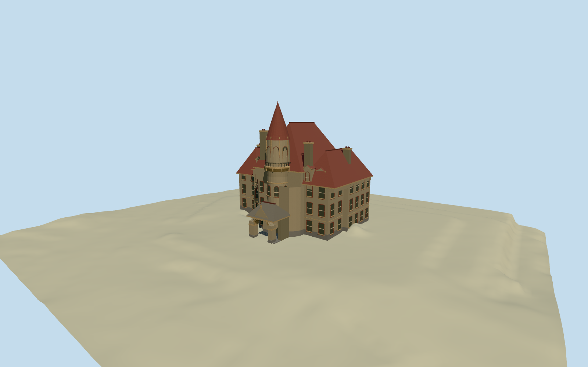

# Craigdarroch Castle

The Craigdarroch stone mansion and round tower, steep red slate roofs, open arched carriage entrance, and flanking chimneys.

Authoring state: **review-in-qa.json**. Current completion evidence is in [qa.json](qa.json) and the [completion ledger](../../../../qualla-structures/batches/qualla-004.PROGRESS.md).

- [Craigdarroch Castle](https://qualla.com/craigdarroch-castle/)

Small carving, decorative ironwork and areas away from the documented elevation are approximated. The tallest finial is narrower than the survey grid and is estimated.

The model is the exterior of the mansion. The interior, grounds and outbuildings are outside the model scope.

Build: `node content/worldgen/source/places/c2/c28/craigdarroch_castle/models/generate-craigdarroch-castle.mjs`. Add `--check` to verify exact regeneration. 11980 triangles; 7 materials; no embedded photographs.
