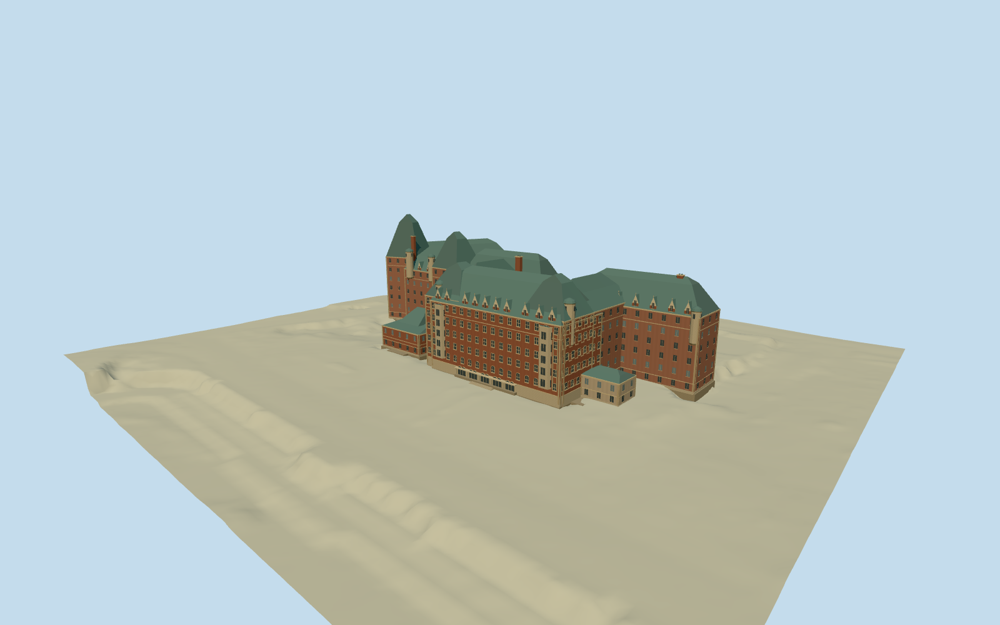

# The Empress (hotel)

The Empress Hotel in Victoria, with its harbor-facing stone entrance, brick wings, steep copper roofs and domed turrets.

Authoring state: **review-in-qa.json**. Current completion evidence is in [qa.json](qa.json) and the [completion ledger](../../../../qualla-structures/batches/qualla-004.PROGRESS.md).

- [The Empress (hotel)](https://qualla.com/the-empress-hotel/)

Draft exterior: approximate photographic proportions and simplified ornament. It is not a survey, photogrammetric reconstruction or approved current geographic replacement.

Parks Canada documents the brick, stone, steep copper roofs, ornate gables, domed turrets, oriels and loggia. FPK-367 shows the expanded hotel from the harbor.

Terrain sampling/contact, geographic alignment and site activation remain pending. Runtime LODs are produced by the registered after-import pipeline and require visual review.

Reference photos remain in the local Qualla corpus; only provenance, paths and hashes are retained here.

Build: `node content/worldgen/source/places/c2/c28/empress_hotel/models/generate-empress-hotel.mjs`. Add `--check` to verify exact regeneration. 38373 triangles; 6 materials; no embedded photographs.
