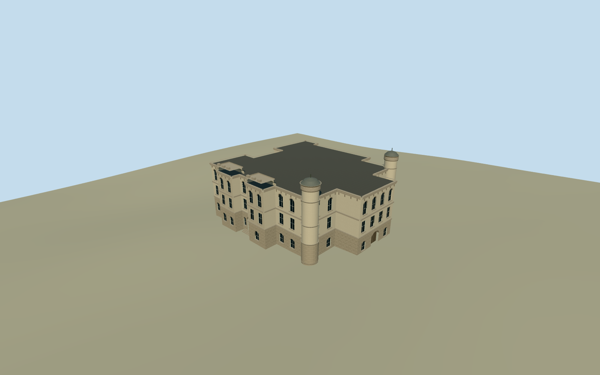

# Former Victoria Law Courts

Former Victoria Law Courts at 28 Bastion Square, with paired capped eastern turrets, stepped entrance towers and coursed Victorian masonry.

Authoring state: **review-in-qa.json**. Current completion evidence is in [qa.json](qa.json) and the [completion ledger](../../../../qualla-structures/batches/qualla-003.PROGRESS.md).

- [Maritime Museum of British Columbia](https://qualla.com/maritime-museum-of-british-columbia/)

The exterior footprint follows the current map. The undimensioned heights, turret diameters, individual openings and cornice mouldings are approximate.

Rattenbury remodelled the courthouse in 1899–1901 and the museum occupied it from 1965 until the public venue closed in 2014. The exterior reflects the standing building. Museum signage, exhibits, later tenant interiors and temporary site details are omitted.

Build: `node content/worldgen/source/places/c2/c28/former_victoria_law_courts/models/generate-former-victoria-law-courts.mjs`. Add `--check` to verify exact regeneration. 14986 triangles; 7 materials; no embedded photographs.
