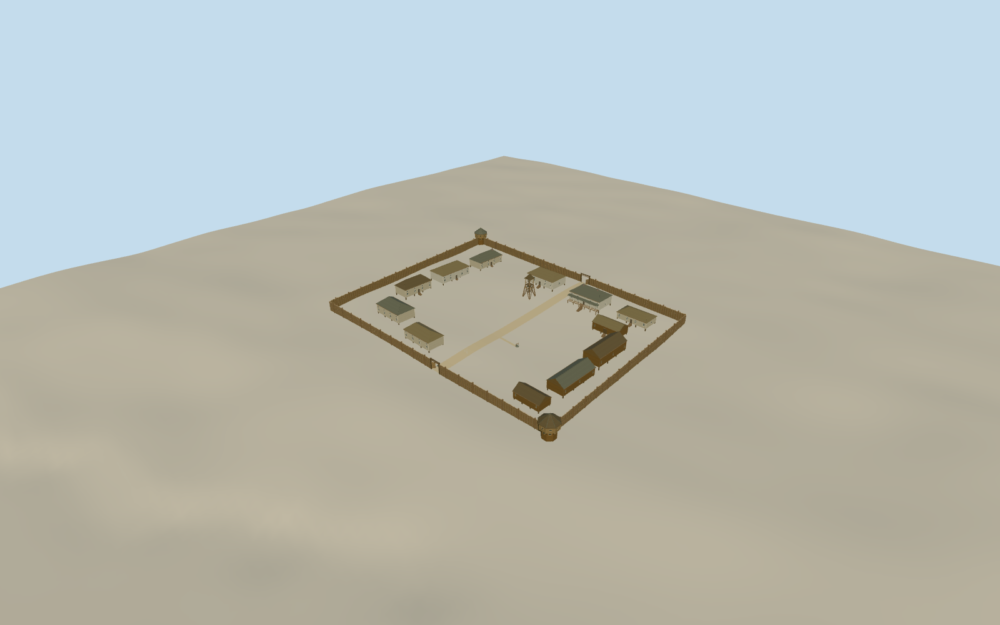

# Fort Victoria, British Columbia

September 1860 Fort Victoria, with both timber bastions, cedar pickets and gates, tall bell tower, and the whitewashed and timber courtyard buildings.

Authoring state: **review-in-qa.json**. Current completion evidence is in [qa.json](qa.json) and the [completion ledger](../../../../qualla-structures/batches/qualla-003.PROGRESS.md).

- [Fort Victoria (British Columbia)](https://qualla.com/fort-victoria-british-columbia/)

Historical exterior of Fort Victoria as it stood in September 1860, before the removal of the northeast bastion and adjoining stockade in December. Building footprints, gate positions within their street alignments, exact gun-floor dimensions, and the disposition of minor structures are estimated from documented historic orientation, period views and the original building descriptions.

Original source terrain is preserved. The fort’s yard, footings and original shoreline relationship are approximate because the height field represents present-day Victoria. The model covers the enclosure and its principal courtyard buildings. External harbor facilities and modern city development are outside the model.

No source image is embedded. Researched exteriors include the buildings, part of the fort road, two gates, two octagonal bastions, bell tower and cedar stockade. Interiors and archaeological foundations are outside the modeled scope.

Build: `node content/worldgen/source/places/c2/c28/fort_victoria_british_columbia/models/generate-fort-victoria-british-columbia.mjs`. Add `--check` to verify exact regeneration. 24156 triangles; 6 materials; no embedded photographs.
