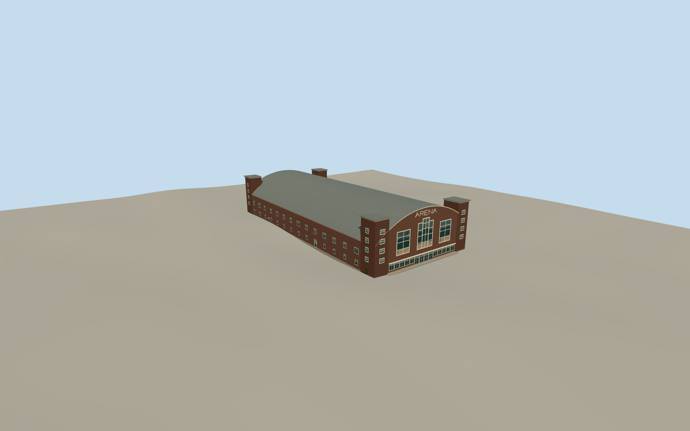

# Patrick Arena

Oak Bay’s 1911 timber ice arena as it appeared for the 1925 Stanley Cup, with its barrel roof, four square corner towers, tall sash windows and street-facing entrance.

Authoring state: **review-in-qa.json**. Current completion evidence is in [qa.json](qa.json) and the [completion ledger](../../../../qualla-structures/batches/qualla-003.PROGRESS.md).

- [Patrick Arena](https://qualla.com/patrick-arena/)

The arena is displayed as a historical structure from its public opening on December 25, 1911 through November 10, 1929. The appearance represents the 1925 Stanley Cup game, using an opening-era photograph.

The archive records the historical address and building dimensions. The absolute setback from the modern intersection and the elevation of the rink floor are estimates.

The source photograph is monochrome. Timber and roof colors, the far end wall, height, side window rhythm, and roof details are reconstructed from appearance, proportions, or period construction descriptions.

The exterior includes the rink hall. The separate engine house, rink interior, street furniture and later neighborhood buildings are outside the model scope.

Build: `node content/worldgen/source/places/c2/c28/patrick_arena/models/generate-patrick-arena.mjs`. Add `--check` to verify exact regeneration. 4050 triangles; 5 materials; no embedded photographs.
