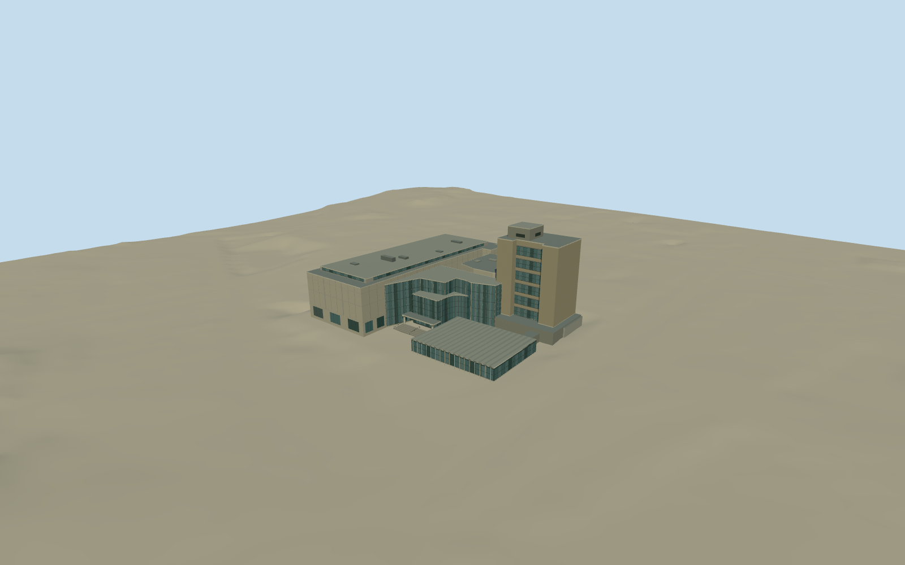

# Royal British Columbia Museum

The standing Royal BC Museum with its limestone Fannin tower, folded-roof archives, tall glazed entry, IMAX and broad exhibition roof.

Authoring state: **review-in-qa.json**. Current completion evidence is in [qa.json](qa.json) and the [completion ledger](../../../../qualla-structures/batches/qualla-003.PROGRESS.md).

- [Royal British Columbia Museum](https://qualla.com/royal-british-columbia-museum/)

Height bands use native roof samples and provincial engineering dimensions. Curtain wall panels, stone tones, stair widths and individual roof fixtures are approximate. The photograph-derived exterior features are matched to the building phase identified in the current operator records.

The scope includes the connected museum masses and the BC Archives wing at the entrance. The independently located carillon and historic precinct houses have their own identities. Interiors, exhibits, temporary signs and display pieces are outside the modeled exterior.

Build: `node content/worldgen/source/places/c2/c28/royal_british_columbia_museum/models/generate-royal-british-columbia-museum.mjs`. Add `--check` to verify exact regeneration. 4610 triangles; 6 materials; no embedded photographs.
