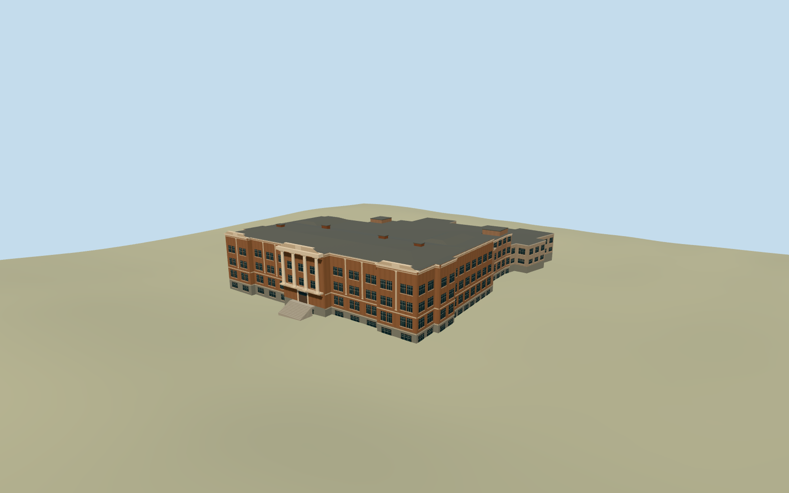

# Victoria High School

The Edwardian school with brick and pale terracotta façades, an Ionic Grant Street frontage, and lower modern additions at the rear.

Authoring state: **review-in-qa.json**. Current completion evidence is in [qa.json](qa.json) and the [completion ledger](../../../../qualla-structures/batches/qualla-003.PROGRESS.md).

- [Victoria High School (British Columbia)](https://qualla.com/victoria-high-school-british-columbia/)

Floor heights, stone stair levels and roof profiles are estimates. The historic rendering shows the original façade before completion. Current preservation records and native plan controls take precedence for the modern sections.

Modern wing heights, exact internal phase boundaries, north window counts and roof overcladding are approximate. The model places the northeastern and northwestern circulation projections within the mapped envelope.

The unmodified elevation serves as the grade reference. Thresholds and trim are modeled at medium fidelity, with the school crest and exterior signage simplified.

Build: `node content/worldgen/source/places/c2/c28/victoria_high_school_british_columbia/models/generate-victoria-high-school-british-columbia.mjs`. Add `--check` to verify exact regeneration. 6548 triangles; 6 materials; no embedded photographs.
