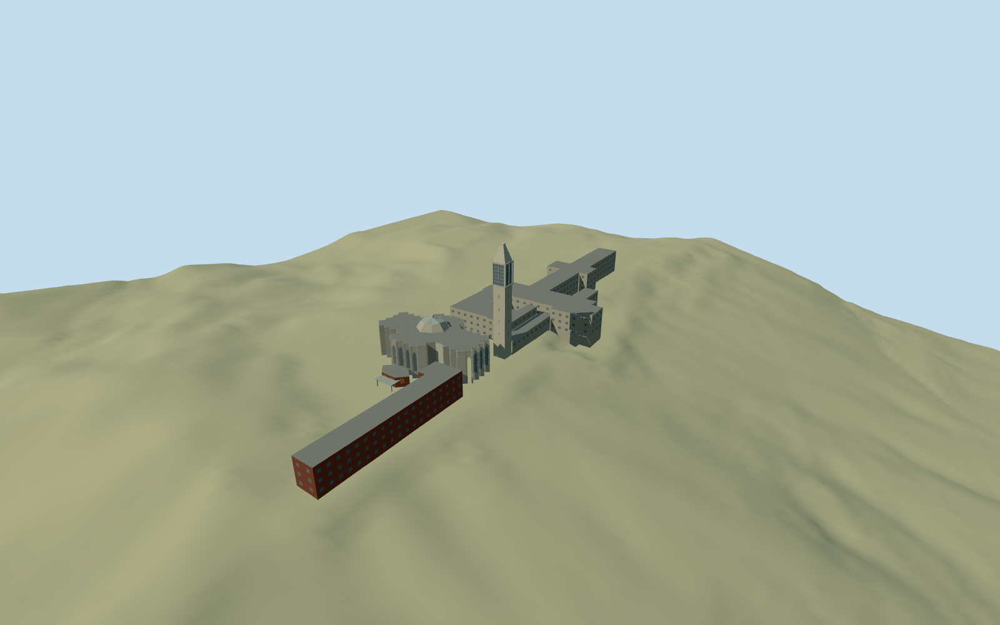

# Westminster Abbey (British Columbia)

A folded concrete abbey church with tall pointed windows, a separate Pfitzer Memorial Bell Tower, and adjoining seminary ranges overlooking the Fraser Valley.

Authoring state: **review-in-qa.json**. Current completion evidence is in [qa.json](qa.json) and the [completion ledger](../../../../qualla-structures/batches/qualla-003.PROGRESS.md).

- [Westminster Abbey (British Columbia)](https://qualla.com/westminster-abbey-british-columbia/)

The folded masonry plan and main roof heights follow mapped outlines and measured surface elevations. Narrow pointed projections, window divisions and stained-glass composition are interpreted at medium fidelity.

The bell tower’s full height is documented. The first-return field resolves its broader crown up to about 44 m, so the upper termination and fine openings are approximate.

The side wings retain their mapped size, roof datum and courtyard. Small facade openings and the chapel approach landscaping are simplified.

Build: `node content/worldgen/source/places/c2/c29/westminster_abbey_british_columbia/models/generate-westminster-abbey-british-columbia.mjs`. Add `--check` to verify exact regeneration. 8029 triangles; 6 materials; no embedded photographs.
