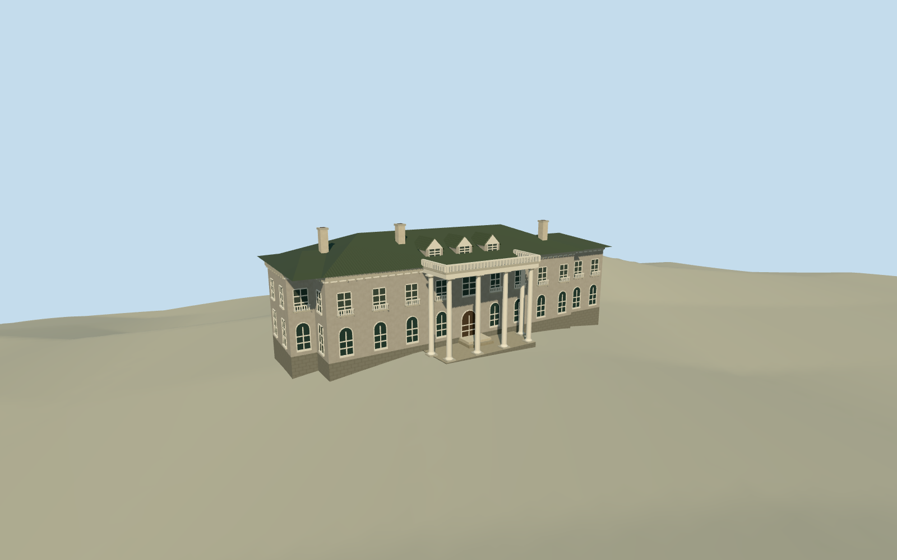

# Hycroft Manor

Hycroft Manor with a green tiled hip roof, three front dormers, Ionic columns, concrete balustrades, and an open north terrace colonnade.

Authoring state: **review-in-qa.json**. Current completion evidence is in [qa.json](qa.json) and the [completion ledger](../../../../qualla-structures/batches/qualla-004.PROGRESS.md).

- [Hycroft Manor](https://qualla.com/hycroft-manor/)

Main mansion exterior only. Furniture, coach house and estate landscape features are outside this placement.

Heights, glazing, roof junctions, north elevation window spacing and concealed details are approximate.

Build: `node content/worldgen/source/places/c2/c2b/hycroft_manor/models/generate-hycroft-manor.mjs`. Add `--check` to verify exact regeneration. 14259 triangles; 6 materials; no embedded photographs.
