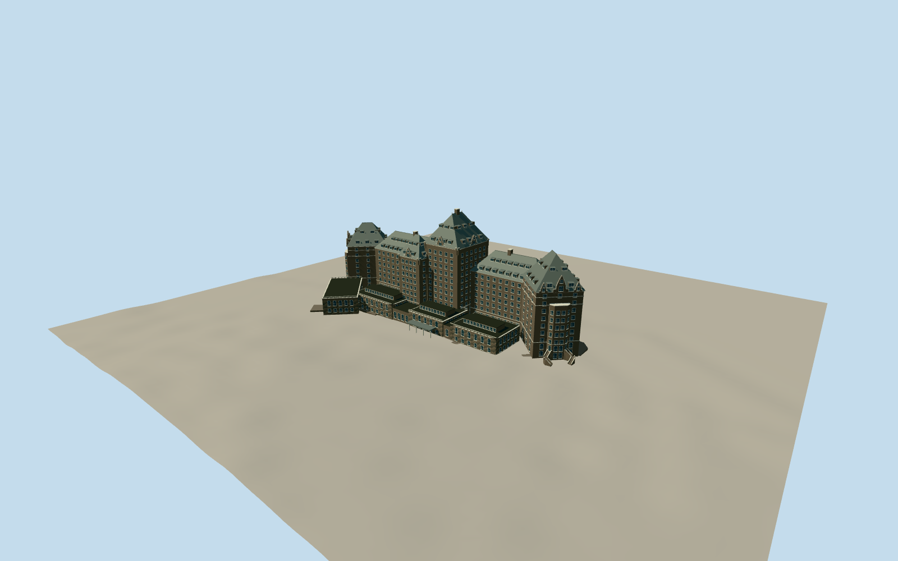

# The Fairmont Banff Springs Hotel

Dark Rundle-stone main hotel with eleven-storey central tower, steep green-gray copper roofs, stacked shed dormers, angled end pavilions and lower public-room wings.

Authoring state: **review-in-qa.json**. Current completion evidence is in [qa.json](qa.json) and the [local 100 ledger](../../../../qualla-structures/batches/PROGRESS.md).

- [The Fairmont Banff Springs Hotel](https://qualla.com/banff-springs-hotel-ghost/)

New south-pavilion paired two-stage stairs use three exact native cleared Qualla public-domain photographs, with a native2007stair detail. Previous attribution photographs, private plan and satellite imagery are excluded as current imagery controls. Main hotel/Rundle scope retained.

Each stair branch has two12-tread flights, solid side walls, pale caps, an open turn landing and an attached upper landing. Nominal18cm rises/4.32m upper floor, widths and inferred plan angles are authoring estimates; no survey dimensions or exact masonry profiles claimed.

Heights, roof intersections, hidden elevations, masonry courses and detailed ornament are photographic interpretations, not measured architectural drawings.

Main stone hotel and Rundle cross-wing included; later Gatehouse, conference buildings, pool/spa additions, landscape terraces and interiors excluded.

Independent terrain is unflattened. Actual footprint placement supersedes the displaced story point; footprint suppression remains disabled.

Build: `node packages/worldgen/scripts/generate-authored-places.mjs --ids=banff_springs_hotel`. Add `--check` to verify exact regeneration. 55974 triangles; 4 materials; no embedded photographs.
