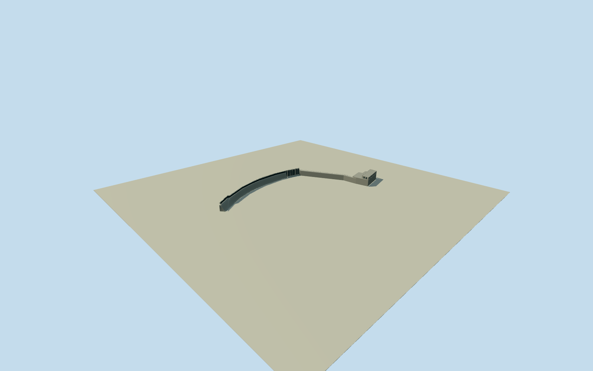

# Black Eagle Dam

Whole native32-control1927BlackEagleDam: lowcurvedconcretegravityspillway/ogee,25removableflashboardbays and uprightsteelposts,8wastegates, continuousnarrowmaintenancewalkway, intrinsicforebaywall and northintake/powerhouse. ExactpublishedTim1965PD1988image first; nativewholeplan/generator and primaryFERCdimensions. Hiddenpowerhouse roof/openings and currentupgrades bounded engineeringestimates. Naturalwaterfalls/river/water/siteground/old1891dam/RyanDam excluded.

Authoring state: **review-in-qa.json**. Current completion evidence is in [qa.json](qa.json) and the [completion ledger](../../../../qualla-structures/batches/qualla-002.PROGRESS.md).

- [Black Eagle Dam](https://qualla.com/black-eagle-dam/)

Actual named closed32-control BlackEagleDam/forebaywall/intrinsicnorthpowerhouse envelope, fixednativebboxanchor/heading0 before independentfield/floor/sections/geometry. Wholephysical outline, not entire reservoir/falls/projectland.

Whole surviving1927BlackEagleDam/Q4920713/nativeway405794349: curved concrete spillway, removable flashboards and maintenance walkway, wastegate/abutment, narrow intrinsic forebay wall and attached north intake/powerhouse within native32-control polygon. Native generator501827237 binds the northeast mapped block to the powerhouse, not a generic abutment. Separate naturalfalls/river/water/rocks/old1891dam/otherdam/sites/substation/roads/ruins/longdownstreamtailrace excluded. Keep whole native footprint; hidden building/roof/opening details bounded estimates.

Original512m129field/16641samples/one raw tile/nativefixedanchor/heading0 frozen before once-onlyfloor-5.1673m. PrimaryFERC1996damheight34.5ft=10.5168m above streambed; flashboardheight11ft=3.3528m and25bays fromFERC1993reportedfacility. Wastegate8bay census/photoestimated;32.004m run fromFERC105ft. Nativepath/footprint controls retained without scaling entireforebay/powerhouseextent to782ftdamlength. Intrinsicnorthhallwidth15.24m fromFERC50ft; nativeblock includes widerintake. Roof18.2/intakeroof13m/openingcensus/deck/rail dimensions hiddenengineeringestimates, not survey. Exact2025-26upgrade machinery unrepresented. No later floor/mainsection/originalfield tuning.

Exactpublished1988PDphoto predates2025-2026spillwayupgrades; clearphoto croppedleftend and mainlyhidpowerhouse. Native32controlwholeenvelope/generator and primaryFERCtext bound fullphysicalscope. Powerhousehall partition/roof/openingcensus and currentmachinery/finishes are originalestimates, not survey/currentphotogrammetry. Do notclaim exact2026operationaldevice reconstruction.

No naturalrockfalls/river/water/entirereservoir or downstreamtailrace/sitepad/otherfacilities. Olddam and RyanDam not substitutes. Original512m129field/nativeframe/floor/mainsectionsfixed beforegeometry, no fitting or lateradjustment. Contactunverified/preview/replacementfalse; reviewground/syntheticneighbors are fixtures.

Build: `node content/worldgen/source/places/c8/c82/black_eagle_dam/models/generate-black-eagle-dam.mjs`. Add `--check` to verify exact regeneration. 12601 triangles; 5 materials; no embedded photographs.
