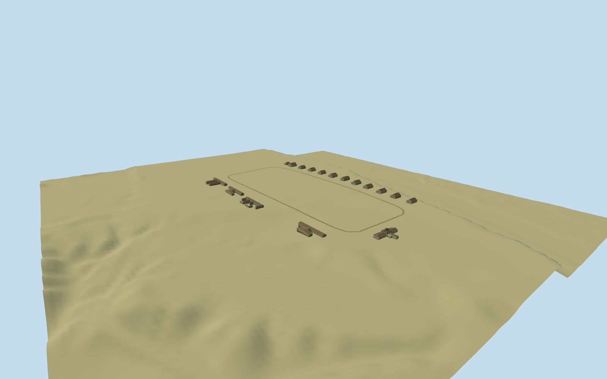

# Fort Custer, Montana

The parade ground at historic Fort Custer, with the officers’ residences, hospital with belvedere and four measured barracks.

Authoring state: **review-in-qa.json**. Current completion evidence is in [qa.json](qa.json) and the [completion ledger](../../../../qualla-structures/batches/qualla-003.PROGRESS.md).

- [Fort Custer](https://qualla.com/fort-custer-montana/)

Fort Custer is represented in the late 19th century. The local museum records the post in 1877–1898 and confirms its buildings are gone. The historical placement is excluded from the current-world view.

Individual relative footprints are traced from the federal survey; the absolute site alignment is approximate. Modern, independently maintained terrain supplies the site relief. The outlying stable, storage and service groups are outside this exterior reconstruction.

The two historical photos are sepia. Colors, unphotographed sides, heights and roof details are interpreted. The four barracks use the documented measured plan and simplified period construction forms.

Build: `node content/worldgen/source/places/c8/c85/fort_custer_montana/models/generate-fort-custer-montana.mjs`. Add `--check` to verify exact regeneration. 12250 triangles; 6 materials; no embedded photographs.
