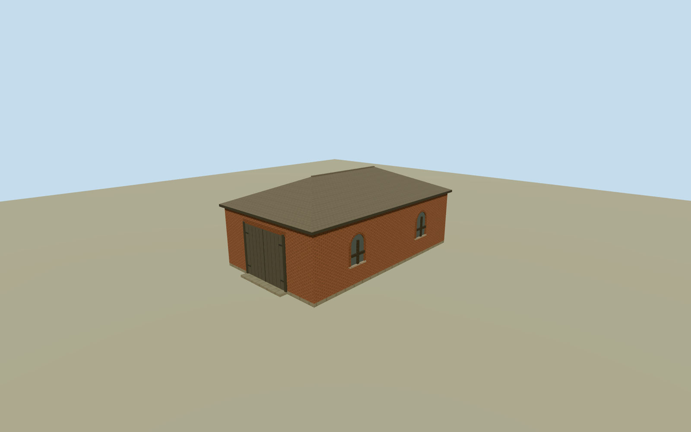

# Fort Keogh Water Wagon Shed

The restored 1883 water wagon shed, a modest brick building with round-headed openings and a low hipped roof.

Authoring state: **review-in-qa.json**. Current completion evidence is in [qa.json](qa.json) and the [completion ledger](../../../../qualla-structures/batches/qualla-004.PROGRESS.md).

- [Fort Keogh](https://qualla.com/fort-keogh/)

This represents the restored water wagon shed. The dispersed historic district and other photographed, demolished or relocated post buildings are outside this structure.

Roof footprint comes from the original overhead image; elevation and façade layout, arched window spacing, door orientation and finish colors are approximate.

Build: `node content/worldgen/source/places/c8/c8h/fort_keogh/models/generate-fort-keogh.mjs`. Add `--check` to verify exact regeneration. 630 triangles; 6 materials; no embedded photographs.
