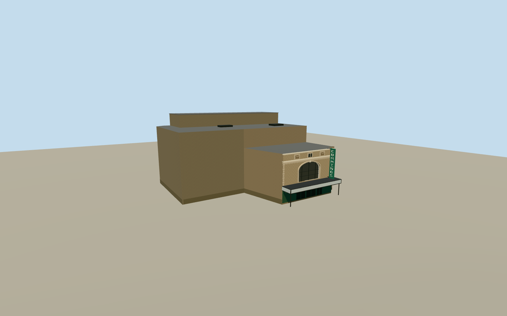

# Burton Cummings Theatre

The 2014 Burton Cummings Theatre in Winnipeg, with its limestone Smith Street arch, green blade sign, cream marquee and attached buff-brick auditorium and stage tower.

Authoring state: **review-in-qa.json**. Current completion evidence is in [qa.json](qa.json) and the [completion ledger](../../../../qualla-structures/batches/qualla-003.PROGRESS.md).

- [Burton Cummings Theatre](https://qualla.com/burton-cummings-theatre/)

The model represents the Burton Cummings Theatre on July 30, 2014, including the Smith Street entrance and the attached brick auditorium and stage block.

The exact Qualla photograph controls the side of the marquee, vertical green sign, and buff auditorium brick. The heritage designation records the limestone arch, third-floor blind windows and modillion cornice. Rear exit locations, tower placement and ornament profiles are reconstructed estimates.

The original elevation field is preserved. Contact follows approximate pavement at the theatre entrance.

Build: `node content/worldgen/source/places/cb/cbf/burton_cummings_theatre/models/generate-burton-cummings-theatre.mjs`. Add `--check` to verify exact regeneration. 4559 triangles; 6 materials; no embedded photographs.
