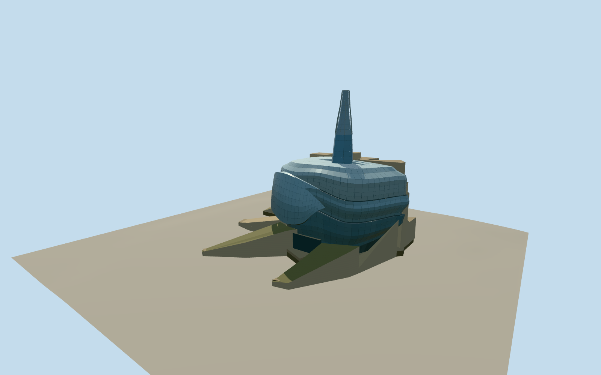

# Canadian Museum for Human Rights

Winnipeg’s Canadian Museum for Human Rights, with angular limestone roots, the layered glass Cloud and the 100-metre Tower of Hope.

Authoring state: **review-in-qa.json**. Current completion evidence is in [qa.json](qa.json) and the [completion ledger](../../../../qualla-structures/batches/qualla-003.PROGRESS.md).

- [Canadian Museum for Human Rights](https://qualla.com/canadian-museum-for-human-rights/)

The dated exterior reflects April 2014. The October 2012 photograph also informs the permanent curved glass and tower. The temporary opening sign, construction equipment and surrounding landscape are excluded.

The named overall outline and mapped parts fix the roots, galleries and tower in plan. The detailed curves, changing glass panel sizes, lattice, roof joins and slopes are simplified and approximate.

The museum’s published 100-metre tower height sets the overall height. Original independent terrain is preserved. The approximate terrain datum is referenced to the south approach.

Build: `node content/worldgen/source/places/cb/cbf/canadian_museum_for_human_rights/models/generate-canadian-museum-for-human-rights.mjs`. Add `--check` to verify exact regeneration. 12994 triangles; 5 materials; no embedded photographs.
