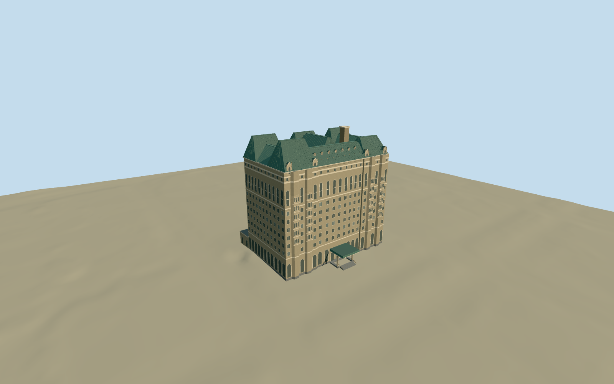

# Fort Garry Hotel

Winnipeg’s Fort Garry Hotel with its buff stone arcades, four Broadway oriels, copper Château roofs and attached dining and reception volumes.

Authoring state: **review-in-qa.json**. Current completion evidence is in [qa.json](qa.json) and the [completion ledger](../../../../qualla-structures/batches/qualla-003.PROGRESS.md).

- [Fort Garry Hotel](https://qualla.com/fort-garry-hotel/)

The standing hotel’s envelope is surveyed. Small dormers, finials, trim, copper tones, rear finishes and the present entrance furniture are approximate. Roof and chimney control heights are tied to original Canadian lidar.

The separate parking building, Upper Fort Garry Gate, Union Station, interiors, sidewalks and adjoining apartments are outside scope.

Build: `node content/worldgen/source/places/cb/cbf/fort_garry_hotel/models/generate-fort-garry-hotel.mjs`. Add `--check` to verify exact regeneration. 21166 triangles; 6 materials; no embedded photographs.
