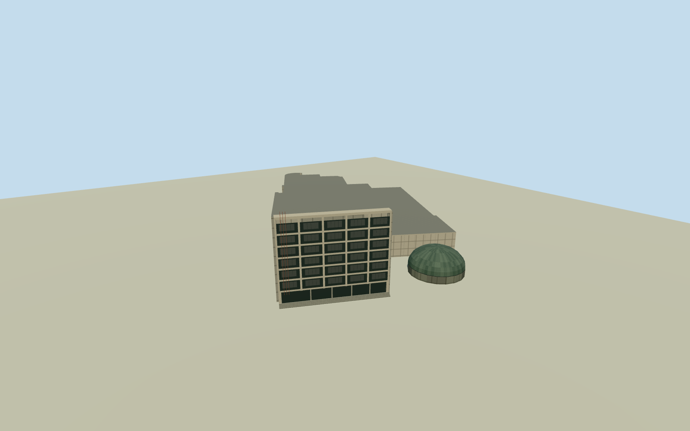

# Manitoba Museum

Winnipeg’s Manitoba Museum with broad concrete galleries, the tall street entrance grid, and the low copper planetarium dome.

Authoring state: **review-in-qa.json**. Current completion evidence is in [qa.json](qa.json) and the [completion ledger](../../../../qualla-structures/batches/qualla-003.PROGRESS.md).

- [The Manitoba Museum: A Full-Size Ship Docked in the Middle of the Prairie](https://qualla.com/manitoba-museum/)

The October 2012 model includes the museum gallery blocks, main street entrance and round planetarium. The separately mapped Centennial Concert Hall and interiors are outside its scope.

The cleared photo constrains the dome and dark window grid. Current mapping stands in for the 2012 rear footprints. Exact glazing, rear roof structures and facade details are estimates.

Original terrain establishes general downtown grade. Small changes at stairs and plazas are approximate.

Build: `node content/worldgen/source/places/cb/cbf/manitoba_museum/models/generate-manitoba-museum.mjs`. Add `--check` to verify exact regeneration. 1659 triangles; 5 materials; no embedded photographs.
