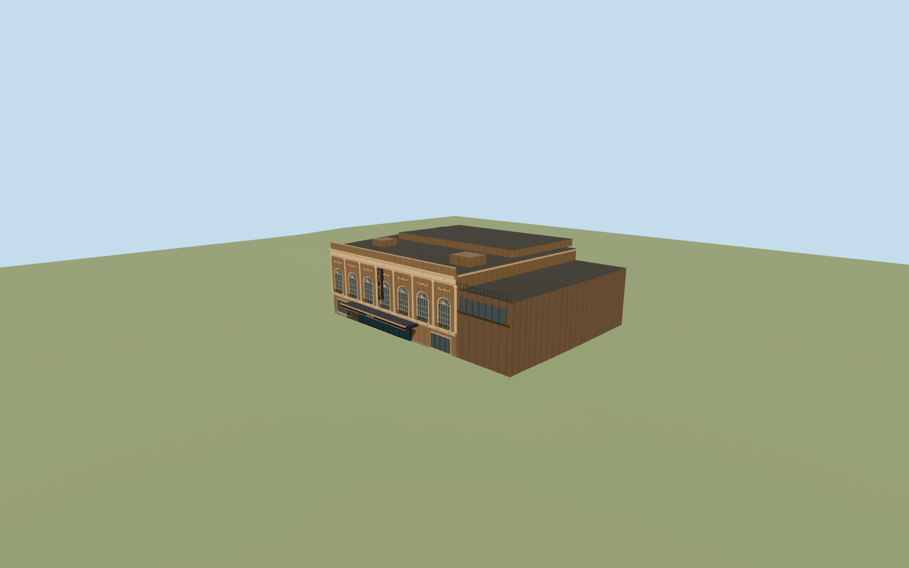

# Metropolitan Theatre

Winnipeg’s Metropolitan Theatre, with seven Palladian windows, terra cotta swags, a projecting marquee and the restored south addition.

Authoring state: **review-in-qa.json**. Current completion evidence is in [qa.json](qa.json) and the [completion ledger](../../../../qualla-structures/batches/qualla-003.PROGRESS.md).

- [Metropolitan Theatre (Winnipeg)](https://qualla.com/metropolitan-theatre-winnipeg/)

Current standing exterior since the 2012 restoration. The 1919 rendering informs the upper façade which remains substantially intact. The drawing’s original shopfronts and original Allen blade lettering are absent from the standing model.

The named footprint is mapped. Roof heights, auditorium roof profile, minor brickwork, modern glazing and lettering proportions, and the south wing are estimated from documented general configuration.

The original stage and dome are inside the building. This exterior includes rear service massing and the restored street canopy. Interior finishes and adjacent venue buildings remain outside scope.

Build: `node content/worldgen/source/places/cb/cbf/metropolitan_theatre_winnipeg/models/generate-metropolitan-theatre-winnipeg.mjs`. Add `--check` to verify exact regeneration. 5508 triangles; 6 materials; no embedded photographs.
