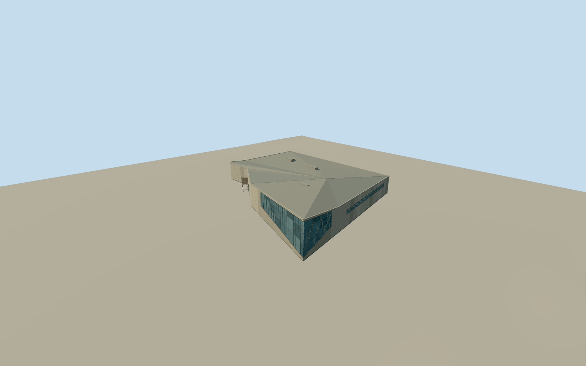

# Royal Aviation Museum of Western Canada

The Royal Aviation Museum of Western Canada, with its tapered hangar envelope, projecting entrance canopy and vaulted glass northwest corner.

Authoring state: **review-in-qa.json**. Current completion evidence is in [qa.json](qa.json) and the [completion ledger](../../../../qualla-structures/batches/qualla-003.PROGRESS.md).

- [Royal Aviation Museum of Western Canada](https://qualla.com/royal-aviation-museum-of-western-canada/)

The native building and entry fix the footprint and orientation. Roof fold, eave heights, canopy, windows, panel widths and airside openings are estimates based on the written architecture and current footprint.

The existing terrain field is preserved. Door thresholds, foundation depths and nearby paving are approximate. Aircraft, interiors, vehicles and other buildings are outside the model scope.

Build: `node content/worldgen/source/places/cb/cbf/royal_aviation_museum_of_western_canada/models/generate-royal-aviation-museum.mjs`. Add `--check` to verify exact regeneration. 5703 triangles; 5 materials; no embedded photographs.
