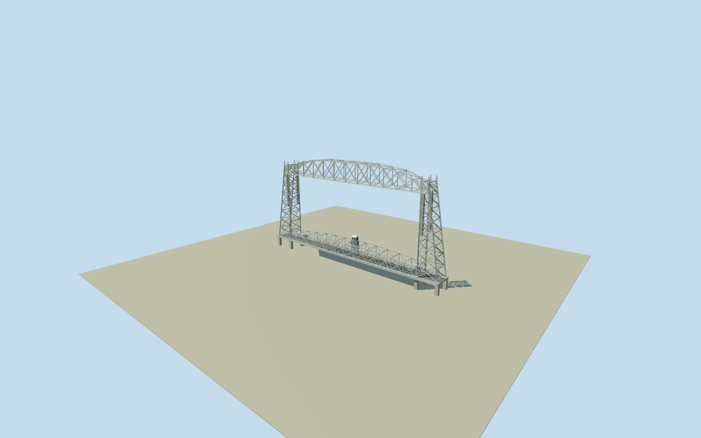

# Aerial Lift Bridge

Complete current Duluth lift bridge in lowered road-open state: original native151mbridge envelope/road axis, paired open battered lattice towers and concrete footings/inner lift guides/high counterweights/cables/top sheaves/pinnacles, fixed original high arched truss with transverse bracing/catwalk, separate low moving road truss/metal deck/sidewalks/rails, central outboard sea-side operator machinery house/upper glazed cab and small end huts. Two inspected2024native Qualla creatorCC0aerials and official owner dimensions; member/hidden mechanical sections and lake/shore contact approximate. No1905gondola, separate breakwaters/lighthouses/museum/shore buildings/water/boats/people/traffic/copied branding.

Authoring state: **review-in-qa.json**. Current completion evidence is in [qa.json](qa.json) and the [completion ledger](../../../../qualla-structures/batches/qualla-002.PROGRESS.md).

- [Aerial Lift Bridge](https://qualla.com/aerial-lift-bridge/)

Original named current movable bridge roadway39240757/Q381123and complete actual bridge areaway1292082350share native endpoint nodes and independently establish full surviving1930bridge identity/envelope. Original full ten-vertex area and endpoint centerline retained; no filled parcel/canal/whole waterfront. Native component heights/footing plans are absent, so tower/upper/lower-truss sections and hidden machinery are explicit interpretations controlled by two clear current2024creatorCC0aerials and official owner/state dimensions. The original1905upper truss survives as a fixed structural member; do not substitute a gondola or merge fixed and moving spans.

Exactly two native4000x2250Bspor.88August2024Qualla originals actually inspected and SHA1matched to pinned Commons explicit own-work/selfCC0releases. Near aerial controls current lattice/upper fixed truss/lowered road truss/guide/weight/sheave/operator-house forms; harbor aerial confirms whole bridge and independent waterfront context. Old1911transporter card, uncreditedPDcandidate and attribution images excluded. No external architectural photograph, generatedbitmap, copied photo texture, lettering or artwork.

Original approximately150.99mroad axis and full ten-vertex actual bridge envelope control plan. Official502ftoverall/386ftmovingtruss/390ftbetween-spans refer to different extents; they are not one global scale. Official225fttop/180ftfixed underside have no explicit surveyed datum, so adopted pavement-relative heights are approximate. Tower batter, footings, truss panel/member sizes, rail/guide/counterweight/cable/sheave details and roof sections are photographic medium-fi estimates, not engineering/as-built survey.

Original high truss remains fixed as an extant1905structural member; the low1930road truss is a separate static lowered span. Large intervening air gap, open lattice towers and underneath water channel stay open. Closeup long built-up members have two rails/open lattice webs, coarser solid rails/representative braces retire fine detail by distance. No operating animation, navigational clearance guarantee, mechanical collision or historic transporter gondola.

Operator house is central along span and outboard on the photographed northeast/sea side, with lower machinery housing and upper glazed cab; road center remains unobstructed. Exact machinery-house sections/conservation/window census and small end huts are estimates. Closed glazing is opaque blue-grey. Traffic, people, boats, lights/flags/signs and copied branding excluded.

Intrinsic bridge road/sidewalk deck and individual concrete footings only; no canal wall/breakwater/lighthouse/museum/neighbor buildings, landscape/site slab or model water. Independent360mrawTerrariumfield frozen before geometry at original north dry-road approach; original source grid/tiles/PNGunchanged without flattening/fitting. Lake level/bank/pier/host datum contact approximate; flatstage is illustrative rather than geographic certification.

Build: `node packages/worldgen/scripts/generate-authored-places.mjs --ids=aerial_lift_bridge`. Add `--check` to verify exact regeneration. 17632 triangles; 4 materials; no embedded photographs.
