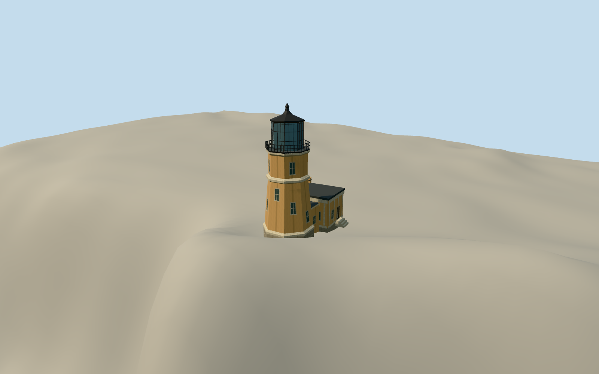

# Split Rock Lighthouse

Split Rock Lighthouse in June 2012, with a buff octagonal tower, glazed iron lantern, exterior gallery, and attached cleaning room on Lake Superior’s North Shore.

Authoring state: **review-in-qa.json**. Current completion evidence is in [qa.json](qa.json) and the [completion ledger](../../../../qualla-structures/batches/qualla-003.PROGRESS.md).

- [Split Rock Lighthouse](https://qualla.com/split-rock-lighthouse/)

The tower scale follows the 54-foot primary record and the mapped diameter. Exact ground contacts, shaft openings, room width, attachment axis, and non-visible side elevations are estimated from the original section and the cleared view.

The independent terrain field preserves the local relief and cliff without fitting. It is a public composite elevation surface, which smooths the vertical rock face and may include above-ground returns.

Build: `node content/worldgen/source/places/cb/cbr/split_rock_lighthouse/models/generate-split-rock.mjs`. Add `--check` to verify exact regeneration. 2182 triangles; 4 materials; no embedded photographs.
