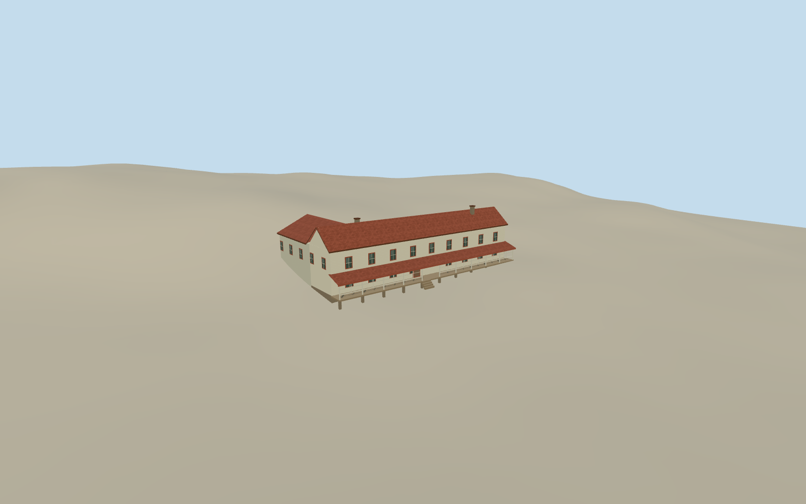

# Kettle Falls Hotel

The two-storey white timber Kettle Falls Hotel with a long south veranda, red roof, rear wing and east lean-to.

Authoring state: **review-in-qa.json**. Current completion evidence is in [qa.json](qa.json) and the [completion ledger](../../../../qualla-structures/batches/qualla-003.PROGRESS.md).

- [Kettle Falls Hotel](https://qualla.com/kettle-falls-hotel/)

The original aerial shows roof massing through the snow. The National Park Service and historic register document the red roof, two-storey L-plan frame, full south veranda and east lean-to.

Window and door spacing, roof joints, lean-to size, veranda screens and foundation levels are approximate. The model represents the 2005 post-restoration hotel exterior.

The original elevation field is preserved. Local rear ground rises to the north wing. Porch access and individual foundation heights reflect the approximate terrain datum.

Build: `node content/worldgen/source/places/cb/cbw/kettle_falls_hotel/models/generate-kettle-falls-hotel.mjs`. Add `--check` to verify exact regeneration. 1183 triangles; 5 materials; no embedded photographs.
