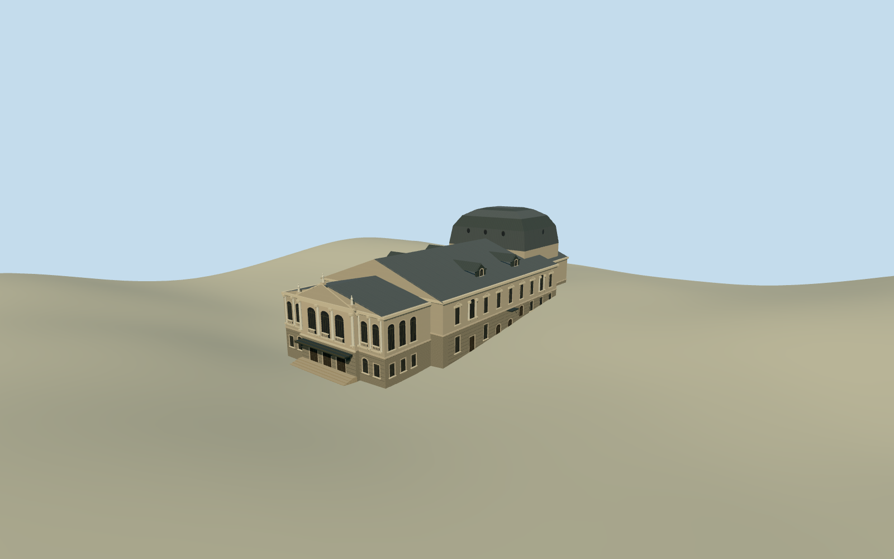

# National Theatre of Costa Rica

The historic San José theatre with its Palladian entrance, broad auditorium and square curved stage dome.

Authoring state: **review-in-qa.json**. Current completion evidence is in [qa.json](qa.json) and the [completion ledger](../../../../qualla-structures/batches/qualla-004.PROGRESS.md).

- [National Theatre of Costa Rica](https://qualla.com/national-theatre-of-costa-rica/)

This models the durable main theatre exterior and original architectural organization. Detached ticket offices, fences and movable interiors are outside the model scope.

Stone coloration, individual reliefs, roof fittings and the profiles of the restored replicas are approximated at landmark resolution. Mapzen terrain captures the site grade at provider grid spacing.

Build: `node content/worldgen/source/places/d1/d1u/national_theatre_of_costa_rica/models/generate-national-theatre-of-costa-rica.mjs`. Add `--check` to verify exact regeneration. 11622 triangles; 7 materials; no embedded photographs.
