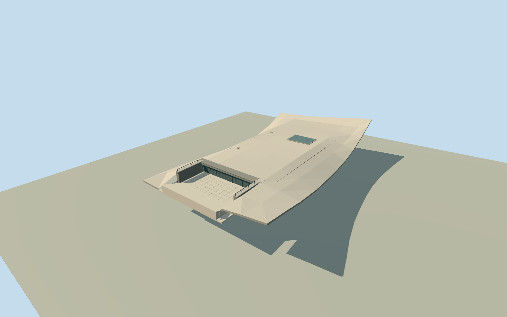

# Pre-Columbian Gold Museum and Plaza de la Cultura

The Pre-Columbian Gold Museum under Plaza de la Cultura, with the built terrace, recessed glass entrance, sloping concrete shell, three sublevels and central spiral stair.

Authoring state: **review-in-qa.json**. Current completion evidence is in [qa.json](qa.json) and the [completion ledger](../../../../qualla-structures/batches/qualla-003.PROGRESS.md).

- [Pre-Columbian Gold Museum](https://qualla.com/pre-columbian-gold-museum/)

Exterior roof bounds follow OpenStreetMap. The portal extent, terrace grades, precise stair/rail geometry, fountain position and modern fittings are estimates informed by the cleared photographs and public site notes.

The three-level internal massing follows the museum owner’s published vertical section facts. The gallery partitions, stair diameter and precise sublevel dimensions are estimated, with a simplified exhibition shell.

An approximate current placement masks the native ground within the actual built plaza boundaries, exposing the entrance court and replacing the modelled roof only. Native terrain data outside the authored roof is unchanged.

Build: `node content/worldgen/source/places/d1/d1u/pre_columbian_gold_museum/models/generate-pre-columbian-gold-museum.mjs`. Add `--check` to verify exact regeneration. 3312 triangles; 6 materials; no embedded photographs.
