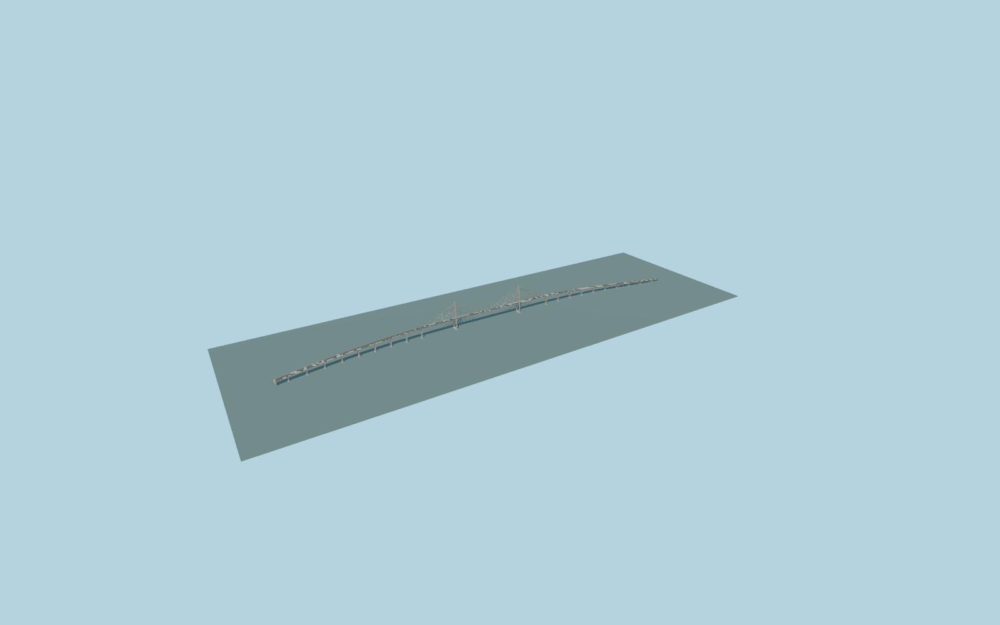

# Atlantic Bridge

Two tall pale inverted-Y concrete pylons, double-plane semi-fan stays over the Panama Canal, four-lane concrete box-girder deck with median lyre lighting and asymmetric curved approach viaducts on twin-column piers.

Source is reproducible offline from models/atlantic-model.mjs, alignment.json and model-brief.json. The full-detail source master remains separate from four authored browser tiers. Shared textures are referenced from the central material library. GLBs are ignored build outputs.

Rebuild with `node packages/worldgen/scripts/generate-atlantic-bridge.mjs`; append `--check` for exact-byte verification. Import and build the four levels with the standard targeted structure import and generate-landmark-lods scripts, selecting `--ids=atlantic_bridge`.

The retained exact-QID outline and current standard PMTiles place the530m main span75m west of the catalog frame center. The curved approaches and asymmetric approximate deck grades are retained. See model-brief.json for picture observations, published structural dimensions and explicit reconstruction limits; qa.json records current visual acceptance. No survey, as-built engineering or physical-device timing is claimed.

Original model geometry uses the repository license. Map-derived controls: © OpenStreetMap contributors, ODbL-1.0; Protomaps basemap. Standard terrain source attribution remains in terrain-samples.json. Contractor photos are linked as references, not redistributed or used as model textures.
