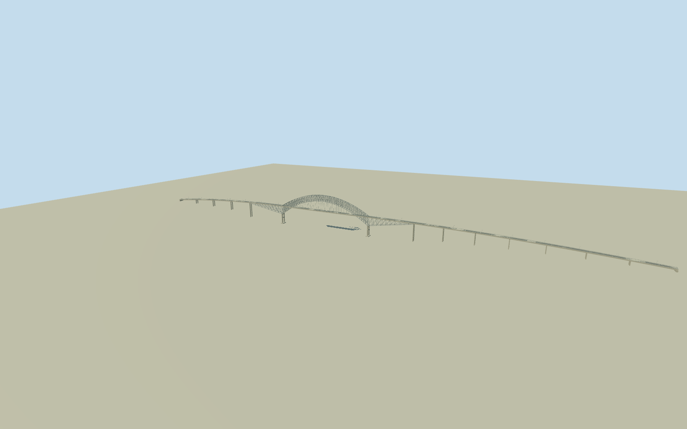

# Bridge of the Americas

Complete native bridge deck/abutments on their original asymmetric1677.7mplan, pale paired curved cantilever/tied-arch trusses over the actual PanamaCanalcrossing,344mmainspan with46slender hangers, physical vertical/diagonal/top cross-bracing, open H-shaped concrete main piers, side arms and graded approach spans. Fourlane roadway, continuous/open rails and restrained lights. Canal/ships/new fourthbridge and landscape excluded.

Authoring state: **review-in-qa.json**. Current completion evidence is in [qa.json](qa.json) and the [completion ledger](../../../../qualla-structures/batches/qualla-002.PROGRESS.md).

- [Bridge of the Americas](https://qualla.com/bridge-of-the-americas/)

Original full named/wikidata bridge envelopeway745707421/Q216061and two named Route1bridge centerlines863696429/147612377. Anchor is their crossing with the original PanamaCanalcenterlineway179053882; +X follows the native NEroad axis. The polygon suspension tag is not an engineering design claim: inspected photographs/local story establish cantilever/tied-arch steel. Nearby186mnew-bridge piers are separate and excluded.

Complete original mapped abutment plan is retained, about1677.7mprojected length. Published1654/1669mfigures use differing end scopes; the native envelope is not rescaled. Its suspension tag is not adopted as engineering design. The separately mapped186mnewbridgepiers belong to another crossing and are excluded.

Main344mspan and46hangers have primary rehabilitation-engineer text support. Photographs control the open curved lattice/cantilever silhouette, Hpiers and roadway. Main pier placement at±172mabout the original channel crossing,54mupper/34mlower crown above deck, steel sections, side arms±325m, approach support spacing and camber/grade remain medium-fi estimates, not a survey or complete structural analysis.

Exact already-cleared/published QuallaPD-selfoverview and two official USNavystaff1984/2011originals used. Their explicit primary Navy/DoDrelease categories and exact native hashes are preserved. No new image was downloaded. Pale steel/concrete/road colors, small fittings, rail and lights are authored approximations; no photographic texture, ships, people, gun, fireworks or landscape adopted.

Fixed original native bridge/PanamaCanalcenterline crossing establishes approximate waterY-64 and deckY0 before terrain acquisition.2.7mslab plus61.3mhigh-waterclearance are controls; tides, pier bases, seabed, road gradient and host-terrain approach contact remain unverified. No water/mountain/port platform or terrain flattening is part of the model.

Curved chord sampling, cross-bracing and suspenders simplify with distance. Skyline keeps both open arch profiles/side arms and concrete support rhythm, with merged approach piers. Fine rail posts, fourlane markings and sparse lamps appear only near. Hidden gussets, rivets, access ladders and actual maintenance gear are omitted.

Build: `node packages/worldgen/scripts/generate-authored-places.mjs --ids=bridge_of_the_americas`. Add `--check` to verify exact regeneration. 23980 triangles; 4 materials; no embedded photographs.
