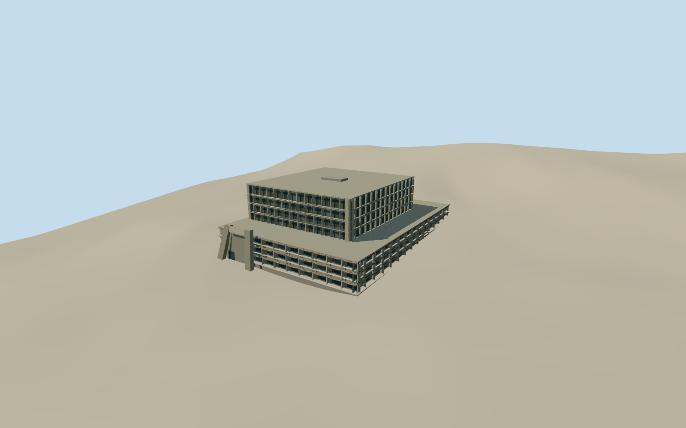

# Gorgas Hospital Oncology Building, Ancón

The Ancón oncology block with its angled concrete entrance, exposed stacked floorplates, recessed glazing and terra-cotta lattice galleries.

Authoring state: **review-in-qa.json**. Current completion evidence is in [qa.json](qa.json) and the [completion ledger](../../../../qualla-structures/batches/qualla-003.PROGRESS.md).

- [Gorgas Hospital](https://qualla.com/gorgas-hospital/)

The 2012 exterior covers the oncology block and its podium on the historic hospital grounds.

The street photo establishes the exposed concrete facade and fins. The tower depth, rear elevations and selected terrace details are estimates.

The original hillside elevation remains unchanged. The podium and street contact use approximate local grade.

Build: `node content/worldgen/source/places/d1/d1x/gorgas_hospital_oncology_building/models/generate-gorgas-oncology.mjs`. Add `--check` to verify exact regeneration. 9888 triangles; 5 materials; no embedded photographs.
