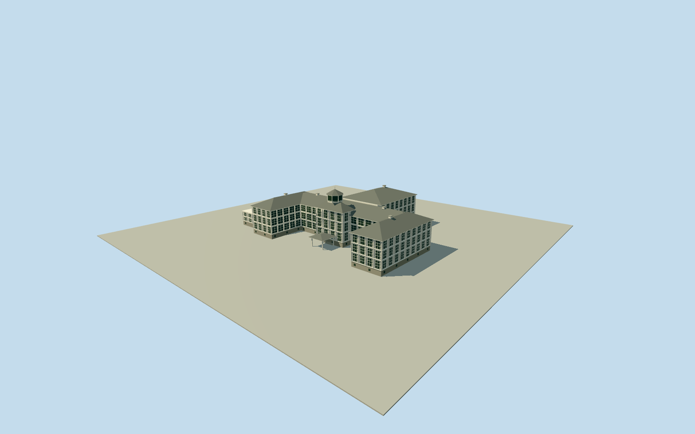

# Tivoli Hotel, Panama (1923)

Dated1923whole main TivoliHotel: broad white timber/plaster frame with repeated dark screened verandah/window bays above a raised masonry base, two projecting front crosswings/open forecourt, central higher front/cupola, connected1911rear wing and visible low attached side block. Separate overhanging hipped roofs, small white roof vents, eight-post cupola/hipped cap and intrinsic1913-era entrance porch/porte-cochere/steps. Full plan/metric scale/bearing are photographic estimates at the former-site story coordinate. Historical-only1923-06-16appearance; no default current-world hotel.

Authoring state: **review-in-qa.json**. Current completion evidence is in [qa.json](qa.json) and the [completion ledger](../../../../qualla-structures/batches/qualla-002.PROGRESS.md).

- [Tivoli Hotel, Panama](https://qualla.com/tivoli-hotel-panama/)

Former hotel identity/location comes from the exact Qualla story coordinate and dated1923NARAhotel aerial. Current native campus1118666247/TupperLaboratory247297016and TivoliBLDG1112176494are different later structures, not a surviving hotel footprint. No historical measured plan was supplied; the complete hotel envelope/bearing/scale below are explicit photographic estimates, retained separately from current native context.

Historical-only1923-06-16appearance from the exact Qualla-published dated NARAaerial. A one-day explicit appearance interval is used rather than inferring unobserved years. The former hotel no longer stands; default current-world placement is excluded. Modern TupperLaboratory/TivoliBLDG/Smithsoniancampus are not adopted as its footprint or modeled as the hotel.

The complete estimated92mwide/65mdeephotel envelope includes front crosswings, main crossbar, central front/cupola,1911rear addition and visible low attached side block. Dimensions, bearing, eaves13.6/15.6m, cupola24.2m, hidden window rhythms and small engineering sections are photographic medium-fi estimates; no historical measured survey exists in the local evidence. Current source context provides location only.

Exact3663x2929NARA/USmilitary1923aerial governs represented appearance. Earlier781x641ErnestHallen/FMIBfront view guides persistent white frame/dark screened verandah/cupola character; its older covered stair is excluded after the documented1913porte-cocherereplacement. The later porch footprint/section remains bounded, not claimed as a measured design.

Dark screened bays are closed visual surfaces with white timber framing over opaque body, not traversable room interiors. Thin frame grid, roof vent sections/finish, neutral warm-white/grey palette and less-visible elevations are original approximations; monochrome prints do not establish exact paint color. No photographic texture, furnishings, detached camp buildings, road/driveway/garden, people or vehicles.

Fixed open front approach selected before terrain sampling controls approximate groundY0. Hotel plinth/porch footings extend.45m beneath it. Exact1923hill grade/foundation/steps and contact with modern host terrain remain unverified; current relief is preserved without a whole-estate platform or terrain flattening. Fine screened window grids, posts, basal vents and roof fixtures simplify with distance.

Build: `node packages/worldgen/scripts/generate-authored-places.mjs --ids=tivoli_hotel_panama`. Add `--check` to verify exact regeneration. 29046 triangles; 6 materials; no embedded photographs.
