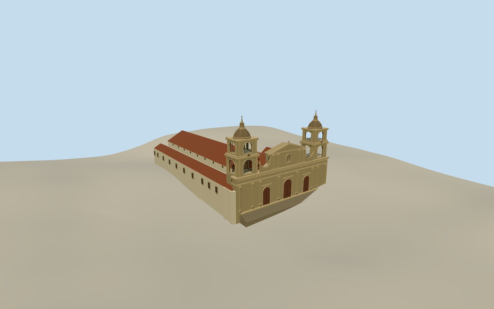

# Primatial Cathedral of Bogotá

The stone Primatial Cathedral of Bogotá faces the plaza with three doors, a pediment and twin belfries surmounted by ribbed domes.

Authoring state: **review-in-qa.json**. Current completion evidence is in [qa.json](qa.json) and the [completion ledger](../../../../qualla-structures/batches/qualla-003.PROGRESS.md).

- [Primatial Cathedral of Bogotá](https://qualla.com/primatial-cathedral-of-bogota/)

The current towers and west facade are the strongest visual evidence. Roof profile, less visible windows, individual ornaments, and minor annex sections are approximate.

The 1846 watercolor is limited to lower facade shape and step arrangement because the upper front was rebuilt.

The attached urban setting and separate chapel are outside the cathedral asset. The original underlying elevation field is preserved.

Build: `node content/worldgen/source/places/d2/d2g/primatial_cathedral_of_bogota/models/generate-primatial-cathedral-of-bogota.mjs`. Add `--check` to verify exact regeneration. 10314 triangles; 6 materials; no embedded photographs.
