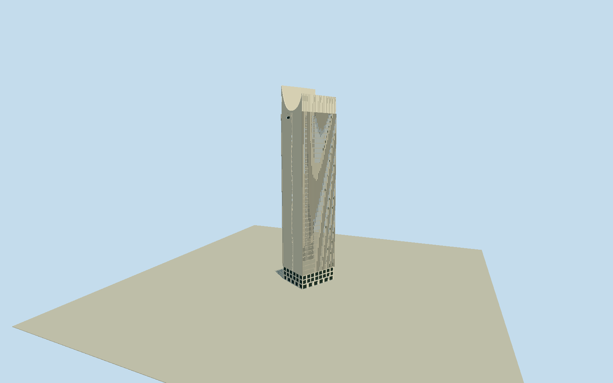

# Coltejer Building, Medellín

Whole surviving Coltejer principalstructure: completeoriginal7vertexmappedgroundenvelope andtower+intrinsiclowcommercialplatform, tallshaft withtwooppositebroadfinned/recessedglazingfaces andnarrowwhiteendwalls/centralverticalwindowstack, characteristic175mtallnorth/loweroppositecrownblades joinedbycurvedendwalls andupperwindoweye, wholeback/side/roof andbounded3levelretailfront/passage/columnrhythm. Not detachedneedlecap/façade-only oruniform175mextrusionofallcommercialreturns. Native38levelsnotadoptedasfloorcensus; municipal175m/36floors controlsnominalmainheight. Exclude ParqueBerrio/church/CulturePalace/adjacentindependentblocks/plazas/trees/flags/people/vehicle/interioroffice/basements/exactbrands/logos. Keepwholeoriginal7vertexgroundenvelope; physical3levelcommercialbase/passagecolumnrhythm andfulltallshaft/wholeback/sides/roof. Allocateoriginalmain0/1/2/3/6shaftandprojecting3/4/5/6platformasaboundedcomponentsection, notnativeheightmeasurement. Tallcrown hasnorthernlongblade175m andloweropposite165m, curvedwhiteendwallprofilesdroppingtowardmechanicalroofyard151m betweenblades, upperlargehorizontaleye/windownearoneendwall. Do notmakegenericboxwithcentralantennapointoruniform175mretailreturn. Broadnorth/southwindowfieldsarebehindstrongthinverticalconcretefins andfloorbreaks; narroweast/westendwalls predominantlywhite/stone withcentralwindowstack/recess andupperlargewindow. Primary36nominalfloors, representative33officebandsabovethreelowlevels, exactfloorpartition/censusnotasurvey. Street/closeuprealglazing/portalrecesses andgroundpassagevoids; distantflattenfin/cellcounts preserve175msilhouette/threelevelreturn. Omitneighboringchurch/palace/plaza/flags/roofantennas/lettering/tenantsinteriors/basements. Freeze400mfieldatfixedsouthstreetapproachbeforegeometry; rawvaluesunchanged/no fit orflatten. Exactcurrentcosmeticstate/hiddenrear/retailroof/sectionboundaries approximatedexplicitly.

Authoring state: **review-in-qa.json**. Current completion evidence is in [qa.json](qa.json) and the [completion ledger](../../../../qualla-structures/batches/qualla-002.PROGRESS.md).

- [Coltejer Building](https://qualla.com/coltejer-building/)

Complete named nativeway31973359/Q3057904 withall7originalbuildingvertices, fixednorthupanchoratmeanoforiginalvertices/heading0, +Xeast/+Zsouth/+Yup. Originalwholemappedcomplexenvelope retained. Heightsandinternalpartboundaries are NOT suppliedbyOSM38-leveltag: mainshaft usesoriginalpoints0/1/2/3/6 andprojectingreturn3/4/5/6 isbounded3levelcommercialplatform interpretation, notsurveyedcomponentmapping. Municipal/CTBUH175mheight/36floorsandprimaryheritage3levelplatform/asymmetricnorthhighercrowntext guideprofile; nativewhole7pointgroundplan remains authoritative. No176mretailwing extrusionorwrongParqueBerriocamera pointasbuildingcenter.

Completeoriginal7vertexwholemappedbuildinggroundenvelope, tallshaft/fullback/sides/roof andlowconnectedcommercialreturn, asymmetric175mtallnorth/165msecondarycrown andcurvedendwalls/upperhorizontalwindoweye. Native38levelsnotblindlyadopted; municipal175m/36floors honorprincipalsilhouette. Internalshaft0/1/2/3/6 vsplatform3/4/5/6 allocation/12.6mbase/151mroofyard/165msecondaryblade areboundedphoto/textsectioninterpretation, not measurednativecomponentheights.

Exact1200x1600publishedQuallaSajoR2007original individuallyinspected/SHA1matched/nativeownPD-selfreleasebound/existingpolicy passes. Qualla-first22families/0conflicts. Do notmistakesamecreatorCentroColtejer-Medellin.JPG/CC-BY-SA2.5forPD; otherCONOCERtransfer/attributionpictures unused. No sourcebitmap/generatedphototexture/downloadedmesh/municipalvideo/photo/architecturaldiagram adopted.

Broadnorth/southfinnedfacades haveactualdetailedstonejambs/recessedglazing/floorbreaks; narrowendwalls predominantlywhitewithcentralverticalwindowstack/upperwidewindow. Detailedrepresentative33officebands/3lowlevels andcolumn/fin/portal countsdonotclaimspecificcurrentfloor/windowcensus. Distantflattenedwindowcues/coarserfins; whole175mcrown/lowreturn retained. Exactrefit/currentpaint/interiorrooms/tenantbrands/rooftopantennas/flags/basements omitted.

ForegroundQuallaphotochurch/trees obscurelowerbase, so retailglazing/passage/roofs/backfineprofiles andexactshaft-platformboundary are boundedwholeexteriorestimates ratherthanfront-onlycrop. Groundcommercialreturnphysicallyopenbelow4.2mcolumn-supportedlevels, withboundedstairs/portalrhythm. No adjacentindependentParqueBerrio/church/CulturePalace/building/plaza/road/tree/people/traffic/sitefloor.

Independent400m129x129field/16641originalvalues/rawsource tilebytes frozenbeforegeometry/unchanged withoutfit/flatten/reacquire. Compositeurbanheightsmayinterpolatestructures/vegetation; notsurveyedstreet/threshold/passagegrade. Portable/shared/contextflatgroundseparate. Ordinarynativepreview/replaceFootprint=false; actualhostattachmentunverified.

Build: `node packages/worldgen/scripts/generate-authored-places.mjs --ids=coltejer_building`. Add `--check` to verify exact regeneration. 31305 triangles; 5 materials; no embedded photographs.
