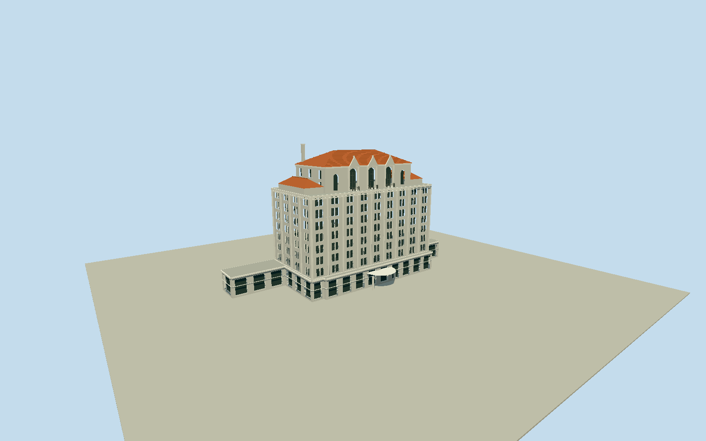

# Hotel Nutibara, Medellín

Whole historic Hotel Nutibara principalbuilding: originalcomplete10vertexnativehotelgroundenvelope, lowwholecommercial/mezzaninebaseandsetbacks/roofterraces, raisedseven-bandrectangularroomblockwithwholeback/sides, recessedpairedwindows/verticalpiers/cornices, narroweruppercrownwiththreeornamentalgabledtallfrontwindows andsemicircularbalconies, redtilehippedroof/shortsidewings/chimney andboundedcoveredentry. Not front-onlycroporuniform40mextrusionofthewholebase. SeparateNutibaraExpress/Residenciasbuilding excluded, alongwithMetro/plaza/palms/roads/neighbours/interiors/basements/signlettering. Retainoriginal10vertexlowbase, containedfullrectangularmainbodyandnarrowerterracecrownasoriginalestimatedpartitions; nativewholegroundenvelopeauthoritative, nosurveyedcomponentheightclaim. Mainbodysevenregularpairedwindowbands, stronglyverticalslenderpalegraypilastersandhorizontalwindowlintels/cornices. Upperfrontthreeelongatedarchedwindowswithornamentalgabledpediments/semicircularironbalconies; twoflankingupperwindows. Redclaytiledhippedcrown/shortlowhippedsidewings/chimney, truewindowrecesses/entryvoids atstreet/closeup. Coarserdistancewindowcueskeepwholemass/threegables/hiproof. Hiddenrear/retail/canopyareboundedwholeexteriorestimates, neverMetro/train/palms/Express/neighbors/roads/sitefloor/interior/signlettering. Freeze400mfieldatfixedfront[3,22]beforegeometry; rawvaluesunchanged/no fit/flatten. Exactgroundattachmentpreviewonly.

Authoring state: **review-in-qa.json**. Current completion evidence is in [qa.json](qa.json) and the [completion ledger](../../../../qualla-structures/batches/qualla-002.PROGRESS.md).

- [Hotel Nutibara](https://qualla.com/hotel-nutibara/)

Originalwhole10vertexhotelway31965744; exactnamedHotelNutibaraPOI358110291/Q5903410 liesinside. Meanoriginalvertexanchor andlongoriginaledge8-to9definefixedfacadewidth+X; +Zpointssouthwesttowardhistoricprincipalfront. Wholeoutlinekept, NOTseparate44vertexNutibaraExpressway1304046292. OSMcontainsnoheight/partboundaries; lowbase/core/upperrectanglesandallheights areoriginalphoto/primarytext-boundedestimates, not surveyednativecomponents.

Exactpublished1024x768SajoR2005Quallapublic-domainhero individuallyinspected/SHA1matched/nativeitemPD-selfreleasebound. Qualla-first5families/0conflicts; uninspectedTichnorpostcard/attribution-onlyphotosunused. Noagencyphotos/architecturediagrams/generatedbitmap/photo texture/downloadedmesh.

Wholeoriginal10vertexlowbase/nativegeographicframe retained; mainroomblock/uppercrownpartitions/heights areoriginalreasonablephoto/primarytextestimates. Base6.4m(doubleheight/mezzanine),7bodybands to29.5m,upper36.8m/hip41m/chimney43m; primarynominaltenlevelsisnotfloor/roomcensus, preciseheightunknown. Notuniform43mextrusionofthebase.

Recognizablepalegrayverticalpiers/pairedrecessedglazing/cornices/sevenbands, narrowercentralcrownwiththreeornamentalgabledtallwindows/semicircularbalconies/redtilehiproof/shortsidewings/chimney. Representativewindow/balcony/columncounts notprecisecurrentcensus; lowerfront/coveredentry/hiddenrear/wings/roofterraces/currentcosmetics bounded. Interiors/basements/signlettering/tenantlogos/retrofitgearomitted.

SourceMetro/train/palms occludelowerfront. Coveredentryslab/twocolumns/retailportalrhythm areboundedoriginalexteriorestimates. Allnativebaseverticesandwholeback/sides retained; notfront-onlycrop. SeparateNutibaraExpress/Residenciasway1304046292 andMetro/plaza/roads/palms/neighbours/people/cars/whole-sitefloor excluded.

Independent400m129x129/16641values/1rawTerrariumtile frozenbeforegeometry withoutfit/flatten/reacquire. CompositeurbanDEMnotstreet/thresholdsurvey; portable/shared/contextflatgroundseparate. Ordinarynativepreview/replaceFootprint=false, actualhostterrainattachmentunverified.

Build: `node packages/worldgen/scripts/generate-authored-places.mjs --ids=hotel_nutibara`. Add `--check` to verify exact regeneration. 18571 triangles; 6 materials; no embedded photographs.
