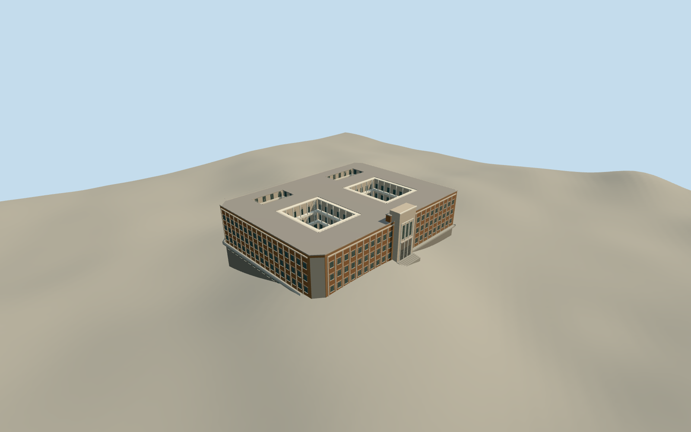

# Museum of Antioquia

Former municipal palace in Medellín with its three-storey Art Deco perimeter, projecting axial arrival and paired open courtyards.

Authoring state: **review-in-qa.json**. Current completion evidence is in [qa.json](qa.json) and the [completion ledger](../../../../qualla-structures/batches/qualla-003.PROGRESS.md).

- [Museum of Antioquia](https://qualla.com/museum-of-antioquia/)

The eight-point outer block is mapped. Courtyard widths and rear lightwells are read approximately from the creator’s location diagram. Roof heights, exterior window details, color and exact grade at the perimeter are estimated from the written survey and available evidence.

The model covers the current palace and open court envelopes. Museum interiors, temporary fittings, sculptures, Plaza Botero and the separate Palace of Culture are outside scope.

Build: `node content/worldgen/source/places/d3/d34/museum_of_antioquia/models/generate-museum-of-antioquia.mjs`. Add `--check` to verify exact regeneration. 13250 triangles; 5 materials; no embedded photographs.
