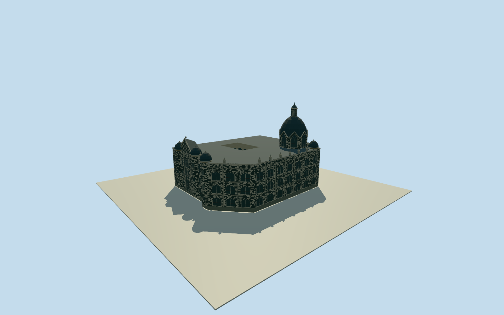

# Rafael Uribe Uribe Palace of Culture

The Medellín palace with checker masonry, clustered Gothic turrets, the principal slate cupola, pale later wings and an open inner court.

Authoring state: **review-in-qa.json**. Current completion evidence is in [qa.json](qa.json) and the [completion ledger](../../../../qualla-structures/batches/qualla-003.PROGRESS.md).

- [Rafael Uribe Uribe Palace of Culture](https://qualla.com/rafael-uribe-uribe-palace-of-culture/)

November 2006 exterior of the constructed palace. Open court and principal roof features are included. Facade carving, window tracery and exact historic eave and dome heights are approximate.

The 2017 CC0 overview confirms surviving massing along the plaza. Street furniture and landscaping are outside the asset.

The original DEM is retained. A viewer opening is limited to the mapped courtyard so the estimated paved floor can remain visible. Exterior thresholds and rear base grades are approximate.

Build: `node content/worldgen/source/places/d3/d34/rafael_uribe_uribe_palace_of_culture/models/generate-palace.mjs`. Add `--check` to verify exact regeneration. 26214 triangles; 5 materials; no embedded photographs.
