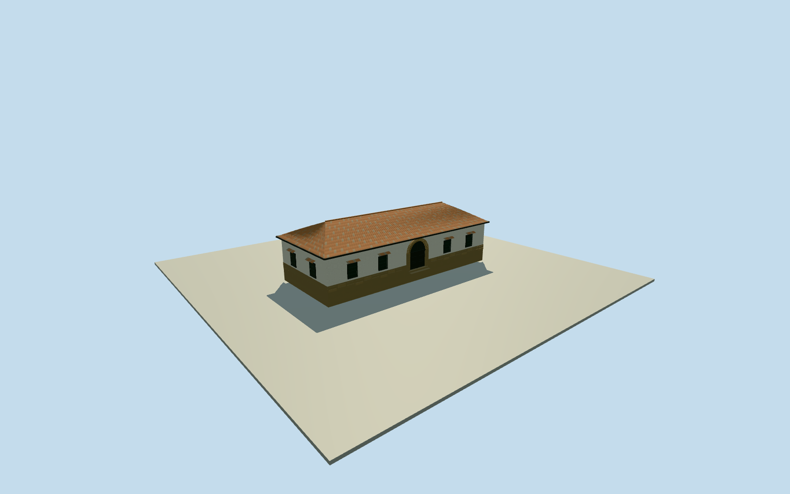

# Paleontological Museum, Villa de Leyva (2009)

Whole old Molino de Osada/Losada house occupied by the Paleontological Museum in its photographed2009 phase: full low colonial house volume, all sides and complete clay-tile roof, stone plinth/white plaster, brick arched timber entry, iron window grilles and tile hoods. Front image is cropped; whole width/depth, hidden rear/window census and roof ends are bounded architectural estimates, not a surveyed campus plan. Keep original mapped museum point, approximate facing and whole house; no neighboring hostel, whole-town/plaza model, museum fossil exhibits, artworks, signage, plants or later proposed2013 campus expansion.

Authoring state: **review-in-qa.json**. Current completion evidence is in [qa.json](qa.json) and the [completion ledger](../../../../qualla-structures/batches/qualla-002.PROGRESS.md).

- [Villa de Leyva](https://qualla.com/villa-de-leyva/)

Actual native named museum node1241294700 fixes the retained location, not footprint or surveyed bearing. Exact Q6033652 names same museum and binds the same Petruss reference filename. Wikidata coordinate is about220m south of the native named POI; retain native location and disclose up to240m intersource registration uncertainty. Street40416233 supplies approximate northeast long axis only; no road ownership. No matching building outline in standard available map context. Whole house dimensions/rear topology are explicit image-led estimates, never neighboring hostel walls.

Exact width/depth, hidden rear topology and all vertical sections are bounded image-led estimates; the source photo crops both outer ends. The full house will have complete exterior volume/closed roof, not an isolated facade.

2009 photographed old-house phase, not a current-campus or2013 proposed new-center certification. Intrinsic exterior only; no copied exhibits/signage/vegetation.

Original independent field/frame must be frozen before choosing all main dimensions/floors/sections; never flatten/reacquire/reframe or fit them to renders.

Whole24x10m one-storey closed country-house body is an original bounded estimate, not a native footprint or measured claim about hidden rear rooms/courts. Full original exterior including all sides and roof retained. Width/depth uncertainty approximately±6m; no exact roof-end/court/topology certification.

Four front barred windows include estimated continuation at cropped/hedge-concealed portions. Rear/side window census and roof ends are bounded estimates. No copied fossils, lettering, coat of arms or artworks.

Photo shows brick arch around dark timber door/transom, irregular stone base and grouped barrel clay tiles. Exact masonry joint census/tile colors and door panels simplified at medium-fi distance.

Only intrinsic house/entry steps included; independent forecourt estate boundary/gate, garden, street and proposed later campus expansion excluded. Original-field current DEM may conceal small parts of base, no terrain cutout or artificial site pad.

Build: `node content/worldgen/source/places/d3/d35/paleontological_museum_villa_de_leyva/models/generate-house.mjs`. Add `--check` to verify exact regeneration. 26675 triangles; 6 materials; no embedded photographs.
