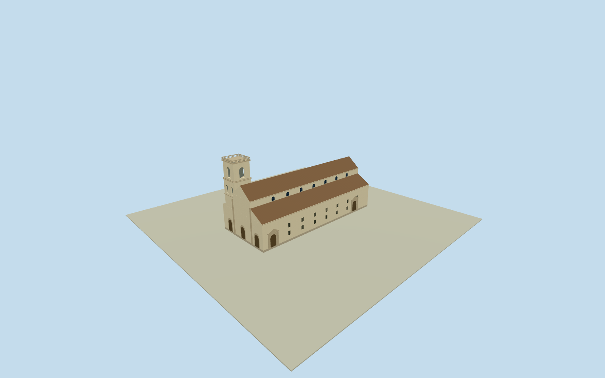

# Cartagena Cathedral, Colombia — whole1870church and original bell tower

Whole historical1870cathedral: complete original native footprint/allfacades, raised gabled nave and clerestory, both full aisle roofs, rear sanctuary envelope, two south entrances and original genuinely open square two-stage flat-topped belfry. Exact owning-museumPDJohnMoran1870photo and original numerical plan; unseen heights/details/palette/grade estimated. No later domed tower or nearby church substitute.

Authoring state: **review-in-qa.json**. Current completion evidence is in [qa.json](qa.json) and the [completion ledger](../../../../qualla-structures/batches/qualla-002.PROGRESS.md).

- [Cartagena Cathedral](https://qualla.com/cartagena-cathedral-colombia/)

Whole historical1870Colombian CartagenaCathedral: complete original six-control church footprint/allfacades, entire raised nave/gable/clerestory and both full side aisles/roofs, east sanctuary/rear envelope and original two-stage square flat-topped bell tower with actual open belfry arches. MuseumPD1870JohnMoranoriginal supplies defining exterior. Unseen details/heights/palette/grade estimated; no single facade, Spanish cathedral, SanPedroClaver, adjacent palace or later decorated domed tower proxy.

Exact original owning-museumP1983.3.4stereograph JohnMoran1831-1902/1870, full native2000px image personally inspected, explicit museum Publicdomain record retained/hashbound. Not governmentO Sullivan attribution: that name is crossed out in object inscription; current museum attribution controls. Qualla-first30families unsuitable or attribution-only, other Spain/colonial-street/nightcity candidates unused. Only this museum historical image used, no galleryUI/otherartwork.

Current original namedQ5047033way49666923/sixunique church controls are retained unchanged as approximate historical1870body registration. Mainchurch63mby26m, native northern edge offsets remain. Image supplies raised central nave/gable and clerestory, lower street-side aisle and its door/window arrangement, original two-stage square flat-topped bell tower. Northern aisle/rear/west-front unseen parts and exact component registration estimated with nominal3mplan/20percentheight uncertainty; no1870survey or facade-only substitution.

After original whole frame and independent256m/16641-height/two-tile field, flat floor0.35m/foundation-0.65m fixed once. Full aisles wall10.8m/inner roof14.8m, central nave halfwidth5.8m/eaves17.5m/ridge22.2m. Entire original footprint/allfacades and both aisle roofs retained, east rear envelope completes sanctuary; hidden internal vaults/rooms not invented. These heights and roof divisions are estimates from cleared1870perspective, not measured architectural sections.

Original northwest tower estimated center[-27,-9]m, full7.7msquarebase, first openbelfry floor15.4m/height6.4m/twoarchedopeningsperface, secondfloor22.2m/height7m/onearchedopeningperface, roof29.5m/topbalustrade30.5m. Physical arches remain genuinely open on all four faces at all LODs, not black facade decals. Exact floor/stage/cornice/bell census/shaft divisions and hidden tower faces estimated; later decorated domed tower explicitly excluded.

Seven clerestory bay positions per full long side, paired barred aisle windows and both south-side Renaissance door surrounds follow the observed1870street-side rhythm with estimated complete census/registration. West-front triple door census, rear windows/pediment/pilasters and north-side details are reconstructed estimates. Complete walls/roofs persist; reliefs are plain procedural moulding/finial masses, no copied religious sculpture or protected modern art.

Warm lime-plaster/stone/dark clay roof/wood/glazing palettes and wear are estimates from monochrome albumen print, not measured1870colors. Shared canonical material graphs provide textures; no photographic pixels baked into material assets.

Historical1870phase only, representedDate1870-06-01 is nominal within known sourceyear, not exact exposuredate; valid1870-01-01to1871-01-01 and currentWorldEligible false. Current urban provider field datum15.4552m/range8.3618..17m is not surveyed1870grade and may overlap/float lower walls. All field/frame/floors/main sections retained through review without cutout/masking/flattening/refetch/refit or cosmetic floor movement. Ground contact and vertical registration remain unverified.

Build: `node content/worldgen/source/places/d3/d3f/cartagena_cathedral_colombia/models/generate-house.mjs`. Add `--check` to verify exact regeneration. 5002 triangles; 6 materials; no embedded photographs.
