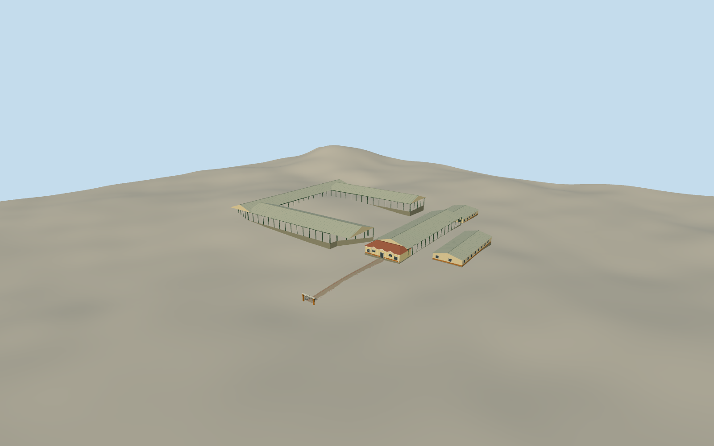

# Aeronautics Museum of Maracay

The former airfield museum at Maracay, with a low red-roofed entrance pavilion, ochre public gate, U-shaped gallery and broad steel hangars.

Authoring state: **review-in-qa.json**. Current completion evidence is in [qa.json](qa.json) and the [completion ledger](../../../../qualla-structures/batches/qualla-003.PROGRESS.md).

- [Aeronautics Museum of Maracay](https://qualla.com/aeronautics-museum-of-maracay/)

The open museum grounds and main building outlines follow the named map controls. Only the structures inside the public museum site are represented.

The gate and principal entrance elevation are derived from period photographs. Their exact ground footprints, roof junctions, finished grades and other elevations are estimates.

The former airfield’s public buildings are presented as they appeared in the September 2021 evidence. Aircraft, vehicles and sculpture are outside the scope.

Build: `node content/worldgen/source/places/d3/d3z/aeronautics_museum_of_maracay/models/generate-aeronautics-museum-of-maracay.mjs`. Add `--check` to verify exact regeneration. 5959 triangles; 4 materials; no embedded photographs.
