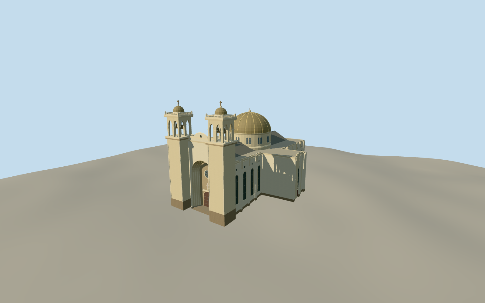

# Metropolitan Cathedral of San Salvador

The cathedral above Plaza Gerardo Barrios with a deeply recessed portal, two open belfries, and a large ribbed crossing dome.

Authoring state: **review-in-qa.json**. Current completion evidence is in [qa.json](qa.json) and the [completion ledger](../../../../qualla-structures/batches/qualla-003.PROGRESS.md).

- [Metropolitan Cathedral of San Salvador](https://qualla.com/metropolitan-cathedral-of-san-salvador/)

Dome section, side openings, bell openings and secondary roof pitches beyond the two main viewpoints will be estimated from the named exterior sources and mapped perimeter.

The photographed nighttime illumination and event projections are temporary. Permanent exterior finishes are interpreted separately.

Build: `node content/worldgen/source/places/d4/d42/metropolitan_cathedral_of_san_salvador/models/generate-san-salvador-cathedral.mjs`. Add `--check` to verify exact regeneration. 22806 triangles; 6 materials; no embedded photographs.
