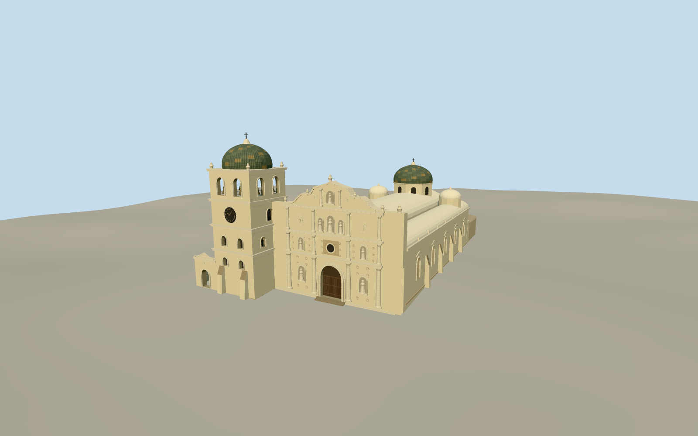

# Immaculate Conception Cathedral, Comayagua

The Cathedral of the Immaculate Conception in Comayagua, with its carved west front, north clock tower, vaulted aisles and five domes.

Authoring state: **review-in-qa.json**. Current completion evidence is in [qa.json](qa.json) and the [completion ledger](../../../../qualla-structures/batches/qualla-003.PROGRESS.md).

- [Immaculate Conception Cathedral, Comayagua](https://qualla.com/immaculate-conception-cathedral-comayagua/)

Public-domain 1859 engraving guides the plaza elevation and south wall. Present clock placement, five domes, relief motifs and the open north patio follow the documented standing cathedral.

The native mapped perimeter and original elevation field fix scale, orientation and grade. The division of the rear chapel and chapter ranges, the paving, the exact thresholds and individual section heights are estimates.

Model scope is the cathedral exterior. The carved saints and heraldic and botanical relief are simplified silhouettes at landmark scale; the historic atrium railing in the engraving is outside the standing exterior scope.

Build: `node content/worldgen/source/places/d4/d49/immaculate_conception_cathedral_comayagua/models/generate-comayagua-cathedral.mjs`. Add `--check` to verify exact regeneration. 22285 triangles; 6 materials; no embedded photographs.
