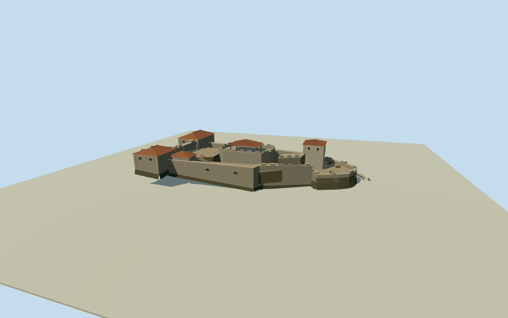

# Castle of San Felipe de Lara

Restored colonial castle with gray river curtains, stepped masonry batteries, tile-roofed lookouts and stone approach bridge at Río Dulce.

Authoring state: **review-in-qa.json**. Current completion evidence is in [qa.json](qa.json) and the [completion ledger](../../../../qualla-structures/batches/qualla-003.PROGRESS.md).

- [Castle of San Felipe de Lara](https://qualla.com/castle-of-san-felipe-de-lara/)

Represents the standing reconstruction with the mapped castle, approach bridge and waterfront stone edge. The river parapet height is documented. Internal subdivisions, other wall heights, turret roof pitches and precise arch and crenel positions are estimates.

The static drawbridge leaf, fittings and courtyard transitions represent visible architectural form. Rooms and moving machinery are outside exterior scope.

The original public DEM is preserved. The waterfront review uses a separate mapped water plane and a coastally adjusted derivative of the original terrain to approximate shoreline grade. Runtime retains the mapped terrain and water. Vertical registration remains approximate.

Build: `node content/worldgen/source/places/d4/d4b/castle_of_san_felipe_de_lara/models/generate-san-felipe-de-lara.mjs`. Add `--check` to verify exact regeneration. 6258 triangles; 6 materials; no embedded photographs.
