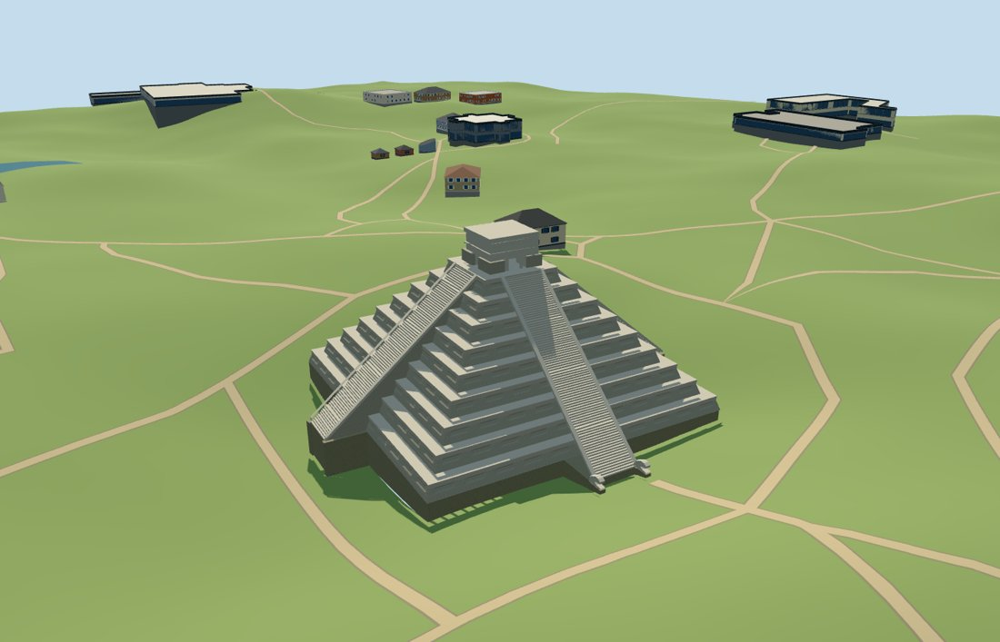

# N0499 — Temple of Kukulcan

Reviewed 2026-10-18. Accepted for the specific medium-fi pyramid exterior and approximate full-site PMTiles/DEM fit. Partial terrain-contact gaps remain pending.

## Exterior and shared materials

Inspected all 11 portable views. Nine mapped limestone stages, four straight stairways, a flat-roof summit temple, three north openings divided by two columns, and the paired north serpent terminals identify Kukulcan. First-render errors were corrected: long sloping map parts no longer become flat beams near the summit, the projecting stairs have solid backing, and the serpent feet have complete foundation support. Near levels use real shallow panel recesses and open serpent mouths with simple eye rims. Panels, columns and sculpted profiles are picture-guided medium-fi approximations; individual stone carvings and erosion are omitted.

Inspected all 11 shared-material views. Three common 256-square ashlar, limestone-grain and dry-stone graphs use metric UVs and linear tints. Three near draws and one skyline draw, with no embedded images or unique atlas. Every graph is read once and eviction frees model geometry. The shared flat stage at Y0 exposes the terrain-following foundations and can show blue beneath elevated edge joins; it is not evidence of geographic contact. Full-site contact was reviewed on the retained actual DEM separately.

## Browser levels

| Level | Triangles | Bytes | Draws |
| --- | ---: | ---: | ---: |
| skyline | 360 | 39412 | 1 |
| district | 2172 | 185260 | 3 |
| street | 10756 | 1122000 | 3 |
| closeup | 15588 | 1655688 | 3 |

Inspected all 27 medium-fi views: street, block and skyline beside procedural buildings at noon and late afternoon, Economy and High, the untextured silhouette, six architectural details, four whole-pyramid levels and all transitions. Skyline360 triangles retains all nine stages and four stair slopes; district2172 adds grouped treads, shrine openings and coarse terminals; street10756 adds selected tread levels and shallow panels; closeup15588 retains all89 mapped tread levels plus summit landings and the open-mouth sculpture. Initial geometry224672 bytes plus three shared material graphs. Separate attribute streams prevent duplicate GPU uploads. Stair/panel detail changes remain visible on upgrade. Physical-device and dense-city measurements remain pending.

## Geographic fit

Reviewed approximate full-site fit on the unchanged 161-square/6m standard DEM. Raw east/south coordinates retain the internal24.02-degree grid, north stair and serpent terminals. The north approach fixes the grade6.194m above the raw reference datum. The exact occupied footprint, including the serpent foundations, has an opaque floor and sampled edge joins at every level. Only this occupied floor opens terrain; a separate guarded convex replacement envelope was checked against every independent map building. Full-site loading removes all174 pyramid/component records and preserves54 independent tile buildings exactly. Three native water features retain5311.744209402124 square metres. Failure keeps all228 native tile buildings and original ground. Eviction restores both surfaces and frees model geometry. Synthetic64m partial residency retains safe failure/eviction behavior but exposes the known renderer sky gaps at temporary clipped floor/terrain boundaries. This limitation remains pending and is not a passed partial-contact condition. DEM/canopy levels and exposed edge foundations are approximate visualization fits, not archaeological survey levels.

## Scope and limitations

Accepted for the specific medium-fi Temple of Kukulcan exterior and approximate full-site standard-map/DEM fit. All174 pyramid/component records remain source controls. The current map supplies nine stage levels,89 tread levels plus summit landings and a30m nominal temple top. The ordinary article gives a24m body plus6m temple and approximately91 steps per side; map resolution does not prove the archaeological step count. Mapped body width is roughly56m versus the article55.3m description; projecting stairs extend the overall footprint and are not used to rescale the body. Sloped face inset, panel count/depth, balustrades, columns, serpent profiles and exposed foundation joins remain visualization estimates. The source preview seats terrain below the occupied floor only for viewing; production uses the unchanged full DEM. Hidden earlier pyramids, chambers, Jaguar Throne and exact carved motifs are not included. Known partial-residency terrain gaps are still an engine limitation and are not approved as correct partial contact. No bespoke survey or archival research was used.

## Source and checks

Two registered recipes plus retained map, terrain and picture-reference metadata rebuild the master and four browser levels. Master:15,588 triangles /1,873,064 bytes. Six Khronos validations have zero errors/warnings. All187 shape/opening probes,1909 mapped exterior/courtyard vertices and1228 occupied-floor samples pass. Inspected49 official and24 site/failure/partial frames. Bulk images stay local.

Source retains all297 local map records, including174 authored controls and123 independent records. The960m production tile contains228 records:174 are replaced and54 independent records stay byte-identical. The replacement guard is a convex envelope checked against every independent map building. The terrain opening follows the complete occupied floor, including serpent foundations. The unchanged original DEM and source attribution are retained; only the source preview has occupied-floor seating.

Selected source/import/placement checks, strict medium-fi audit, scene validation and a30-tick simulation pass. No full corpus rebuild, dependency audit, Git mutation or upload was performed.

Rebuild: node packages/worldgen/scripts/generate-additional-landmarks.mjs --ids=N0499; node packages/worldgen/scripts/import-next-1000-models.mjs --ids=N0499; node packages/tooling/scripts/generate-landmark-lods.mjs --ids=N0499.

Source: sha256:b873be20d8152a9a8f129302dc95a9ba05f663943a31cf2ea5760275a66716ed

Runtime: sha256:2681d49242bf3952d034e8921c065588c6271b63dda2d99d57bb1f9be4ffcc2c

Input: sha256:7e9a833622f21f00b4ba45cea6a2e859a367c2629a5f6d60a79384721b0caa6c

## Ordinary picture references

https://commons.wikimedia.org/wiki/File:Chichen_Itza_3.jpg — Daniel Schwen,18 August2009,CC BY-SA4.0; viewed only.

https://commons.wikimedia.org/wiki/File:Chichen_Norte.JPG — Lfyenrcnhan,10 July2007,Public Domain; viewed only.

https://commons.wikimedia.org/wiki/File:Serpent_head_at_the_base_of_El_Castillo.jpg — Frank Kovalchek,28 March2009,CC BY2.0; viewed only. No picture pixels are shipped.
