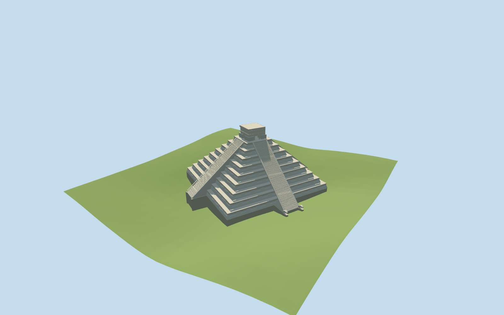

# Temple of Kukulcan

Specific Temple of Kukulcan exterior: nine mapped sloping stages, four straight mapped stair flights, north serpent-terminal sculptures, summit shrine walls/openings, flat roof and cornice bands. Retain the approximately56m body and wider stair projections separately. Shallow recessed wall panels and serpent profiles are picture-guided medium-fi geometry; hidden earlier pyramids and internal artifacts are omitted.

## Evidence and reconstruction

Published dimensions and reconstructed details are separated in spec.json. Primary references:

- [Reference](https://commons.wikimedia.org/wiki/File:Chichen_Itza_3.jpg)
- [Reference](https://commons.wikimedia.org/wiki/File:Chichen_Norte.JPG)
- [Reference](https://commons.wikimedia.org/wiki/File:Serpent_head_at_the_base_of_El_Castillo.jpg)

Three shared256-square stone graphs, metric UVs and linear tints. Stair treads, shallow panel recesses and serpent profiles are geometry, not copied photographs. Two registered recipes rebuild the master and browser levels.

## Model and axes

15,588 triangles; 46,764 vertices; 3 material groups; 1,873,064 bytes. Native bounds: -40.408, -0.632, -48.172 to 33.977, 36.194, 25.794. Source hash: `sha256:b873be20d8152a9a8f129302dc95a9ba05f663943a31cf2ea5760275a66716ed`.

{"x":"east","y":"up","z":"south"}

The unchanged161-square/6m standard DEM and30.280m raw reference datum are retained. A north approach sample at architectural[0,-40] sets the pyramid grade. Only the mapped occupied footprint is excavated; every level has a complete opaque floor and bounded joins to the sampled terrain. Coarse canopy/DEM variations and edge walls are visualization fits, not surveyed archaeological paving levels. Source preview terrain is seated below the occupied floor solely for viewing; the production fixture uses the unchanged full DEM.

## Reproduce

Run `node packages/worldgen/scripts/generate-additional-landmarks.mjs --ids=N0499` (or add `--check`). The generator preserves manually edited masters by checking their baseline hashes. Import through the standard authored-model workflow with optimization disabled; then capture all QA cameras, including shared-surface views.

## Pending work

- Specific Temple of Kukulcan exterior: nine mapped sloping stages, four straight mapped stair flights, north serpent-terminal sculptures, summit shrine walls/openings, flat roof and cornice bands. Retain the approximately56m body and wider stair projections separately. Shallow recessed wall panels and serpent profiles are picture-guided medium-fi geometry; hidden earlier pyramids and internal artifacts are omitted.
- Q1128327/relation3370923 identifies El Castillo. Standard pinned PMTiles building52776561504171 and173 component records retain the actual compound/stair outline, nine stage controls,89 mapped tread levels and summit landings, summit walls/roof and north terminal parts. The internal east axis is24.02 degrees south of east; the north stair and three-opening summit facade face toward local-Z negative. Raw east/south coordinates preserve signed orientation without using the older undirected map axis.
- Current normal-map heights retain stage rises2.66m,89 tread levels plus mapped summit landings to23.94m, summit wall/roof bands to30m. The ordinary article describes a24m pyramid plus6m summit temple and approximately91 steps per side; normal-map resolution does not establish an exact archaeological step inventory. The mapped body is roughly56m across versus the ordinary article55.3m figure; no forced rescaling is applied. Panel layouts, slope inset, balustrade profiles, columns and serpent sculpture are visualization estimates.
- The unchanged161-square/6m standard DEM and30.280m raw reference datum are retained. A north approach sample at architectural[0,-40] sets the pyramid grade. Only the mapped occupied footprint is excavated; every level has a complete opaque floor and bounded joins to the sampled terrain. Coarse canopy/DEM variations and edge walls are visualization fits, not surveyed archaeological paving levels. Source preview terrain is seated below the occupied floor solely for viewing; the production fixture uses the unchanged full DEM.
- Panel layouts, sloped face inset, serpent-head sculpture, round columns and damaged edges remain picture-guided approximations. Fine carvings, exact stone inventories, hidden earlier pyramids, buried chambers and internal artifacts are omitted. Current review status is recorded in qa.json.

This bundle follows the medium-fi standard. Medium-fi appearance and geographic fit are reviewed separately. Hash-bound visual acceptance is recorded separately after capture inspection.

## Additional geographic data

©OpenStreetMap contributors; Protomaps; Mapzen/USGS terrain.
