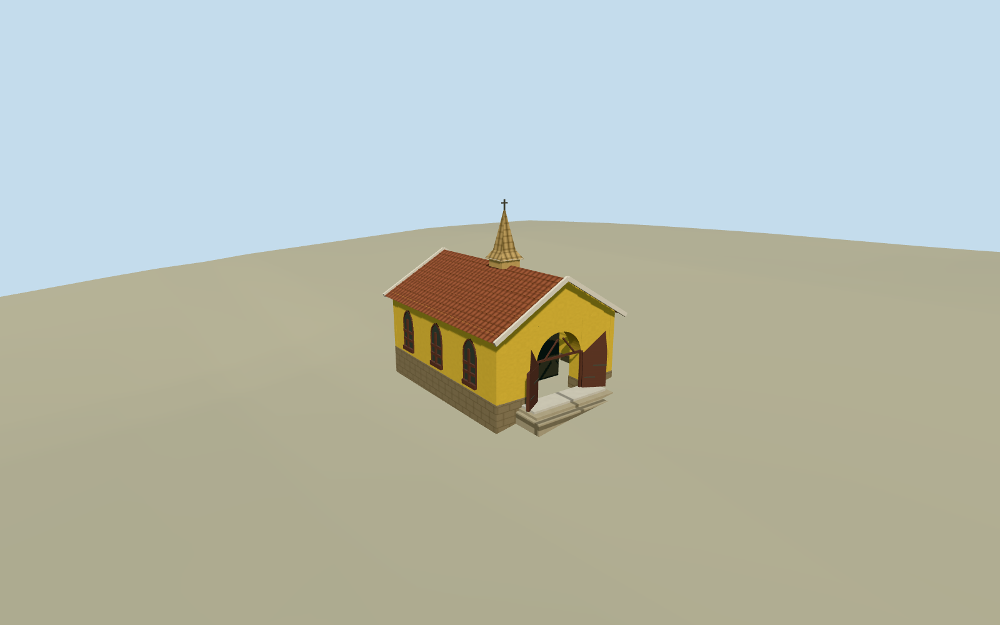

# Alto Vista Chapel

Yellow coastal chapel in Noord with open pointed doors, orange roofing and a narrow tan bell spire.

Authoring state: **review-in-qa.json**. Current completion evidence is in [qa.json](qa.json) and the [completion ledger](../../../../qualla-structures/batches/qualla-004.PROGRESS.md).

- [Alto Vista Chapel](https://qualla.com/alto-vista-chapel/)

Focused on the standing exterior, its orange-red roof and limestone platform. The rear gable, smaller trim and window glazing are approximate.

The extended courtyard, cacti, low freestanding benches and interior furnishings are outside model scope.

Build: `node content/worldgen/source/places/d6/d6n/alto_vista_chapel/models/generate-alto-vista-chapel.mjs`. Add `--check` to verify exact regeneration. 1586 triangles; 7 materials; no embedded photographs.
