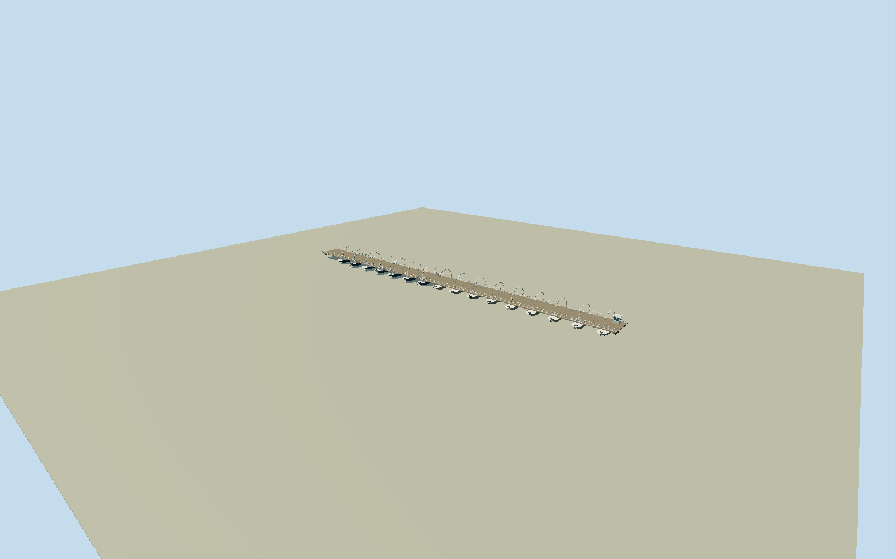

# Queen Emma Bridge, Willemstad

Whole surviving QueenEmmafloatingpontoonbridge in its staticclosed/crossingconfiguration: original6vertexmovingdeckoutline/152.816mcenterline and12.013mfixedhingeapproach,16separateorthogonalboatpontoons, underdeckstringers/crossbeams, restoredwoodwalkway/curbs/openrailings, definingrepeatedtransversearchedlightframes, smallintrinsicglazedoperatorhut/freeendsideplatform/hingeandboundedpushgear. Notonlydecorativearches/flatwalkway. Exclude baywater/wholequay/Handelskadebuildings/city/ships/ferries/people/flags/royalornamentalposts/asphalttrafficmarkings/temporaryrenovationequipment. No whole-site floor. Allnative6movingdeckcorners retained atdeck0, originalnative12mhingeapproachseparate.16orthogonalboatpontoons withchamferedpointedends/shallowtaperedhulls belowdeck, twoopaque mainstringers/crosssupports, woodboarddeck; no water/sitefloor. Mainidentityis repeatedthinwhitetransversehalfellipticarches OVERwalkway, notlongitudinalsidearches.16representativearchframes withoriginalmediumfigauge/railpostcensus; trueemptywalkway/headroom. Thinwhiterails/topandmidbars/realgaps, smallwindowedflatcapoperatorcabinnearPundafreeendandboundedmechanicalpod. Currentrestoredwoodwalkway(noasphaltcenterline) followsoperator/tourismtext; detailedplankseams originalnotphototexture. Tallroyalflagornamentalcolumns/flags/lightedcityoutlines/historiclanemarkingsnotadopted. Underwaterdraft/propellers/hingehardware/2026electrification/paintcolors arebounded ratherthanclaimedcurrentsurvey. Independent400mfieldfixeddrywestapproachbeforegeometry; preserve rawtilebytes/allvalues nofit/flatten/reacquire.

Authoring state: **review-in-qa.json**. Current completion evidence is in [qa.json](qa.json) and the [completion ledger](../../../../qualla-structures/batches/qualla-002.PROGRESS.md).

- [Queen Emma Bridge](https://qualla.com/queen-emma-bridge/)

Named nativeclosedbridgearea894738774/Q182945, all6originaloutervertices andexactmovablecenterline30410363 withseparate12.013mfixedbridgeapproach711130267. AnchoratnativewesternOtrobanda hinge/centerline endpoint; signedheadingfromwholemainspan towardPunda. +Xalongmovingdecktoeast-southeast/+Zperpendiculartowardsouthwest/+Yup. Originalmovingplan152.816m andtotalnativeaxisabout164.83m retained; story167mnominal isnotusedtostretchthemap. Nativewholeenvelopeabout10.8m includesedge/curbwidth;9mquotedusablewidthnotimposed. Individualpontoonhulls/archcensus/section/cabin/heights/underwatermachinery are explicitphotographicestimates, notcurrentengineeringsurvey.

Wholeclosed152.816mmovingbridge/original12.013mhingeapproach,16separateorthogonalboatpontoons and16representativetransversearchedlightframes. Nativeoriginal6deckvertices retained. Thinraisedwoodwalk/openrails/intrinsicoperatorcabin andboundedhinge/pushgear. Not a lonearch/genericfootbridge/citywaterfront. Staticclosedpose; noanimation/collision-clearancecertification/active2026machinerysimulation.

Qualla-first27families/0conflicts; anonymouspublishedmuseumphotos/attributionimages/unverifiedmodernagencycandidateexcluded. Threeexactnativephotographicoriginalsindividuallyinspected/SHA1matched, primaryNationaalArchiefitem-specificownCC0boundbyexistingvalidator:927-8469BertVerhoeff1975wholebridge,252-3109and252-3538WillemvandePoll1955deck/night. Deckviewcorrectlyresolvestransversearchesoverwalkway. No newpolicyexception/siblingmetadatachange, phototexture/generatedbitmap/downloadedmesh/royalornamentalcolumns/flags/copyofnearbycity.

Owner2026electrificationretainsappearance; tourismboard16pontoons/restoredwooddeck textcontrols principalstableform. Historicphotosshowasphaltlane/royaldecorations, notadopted ascurrent. Exactpresentpaintcolors/unrecordedinterimrefits/cabinwindowcount/archcensus/beamgauges/underwaterhullpropulsion/draft are boundedoriginalmediumfiestimates. Mutedwhite/gray/brownwood palette doesnotclaimsurveyedcolorfromblackandwhitephotos.

Deck0/pontoons-1..-2.7m/estimatedwaterline-1.85m/archcrown5.3m arephotoestimates. Floatingcraftareintrinsic bridge supports, nottrafficprops. Actualbarechannel/banks/ships/ferries/quay/facades/trees/people/roadmarkings/renovationequipment/watermesh excluded; no whole-site floor. Openairheadroom/between-boatgaps real atallLODs.

Independent400m129x129field/16641samples/rawtilebytes acquired atfixedlandwardwestapproachbeforegeometry andunchanged. Compositewatercellsincludedeeplowoutliersdown to-379.8896m; diagnosticrawvaluesareNOTsurveyedbathymetry/waterclassification/hostshoregrade. Do notflatten/fit/resampleawaynegativecells. Flatinspectionstage-3.2mseparate; ordinarynativepreview/replaceFootprint=false, realwater/shore/threshold/compatiblehostcontactunverified.

Build: `node packages/worldgen/scripts/generate-authored-places.mjs --ids=queen_emma_bridge`. Add `--check` to verify exact regeneration. 18914 triangles; 6 materials; no embedded photographs.
