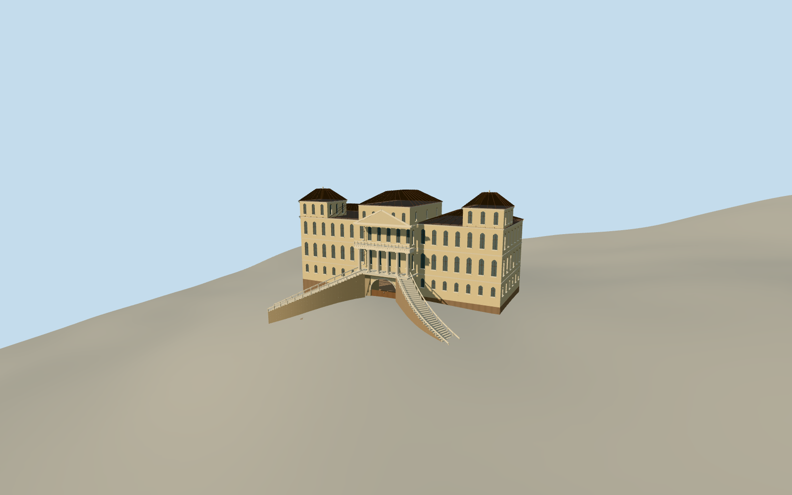

# Sans-Souci Palace

The royal residence at Milot as it stood in the late 1810s, with pavilion roofs, the Doric gallery and a pair of ceremonial stairs framing the north fountain.

Authoring state: **review-in-qa.json**. Current completion evidence is in [qa.json](qa.json) and the [completion ledger](../../../../qualla-structures/batches/qualla-003.PROGRESS.md).

- [Sans-Souci Palace](https://qualla.com/sans-souci-palace/)

Circa 1819 exterior is reconstructed from prints and surviving walls. Individual bay details, elevation, roof structure, finishes and stair grades are estimates.

The original ground samples are preserved. Historic landscaping, annexes, the chapel, interiors and furnishings are outside the main residence model. The stair and footing grade are approximate.

Build: `node content/worldgen/source/places/d7/d7k/sans_souci_palace/models/generate-sans-souci-palace-milot.mjs`. Add `--check` to verify exact regeneration. 26203 triangles; 6 materials; no embedded photographs.
