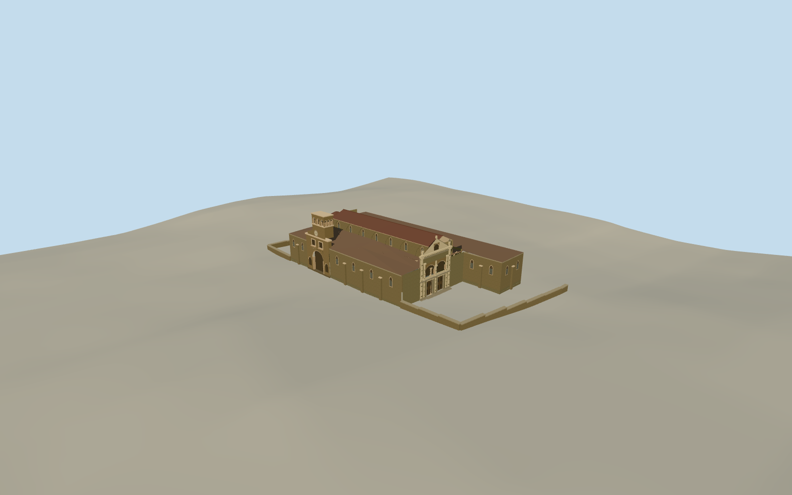

# Cathedral of Santo Domingo

The Cathedral of Santo Domingo in 1899, with its three Gothic naves and ribbed vaults, limestone chapel elevations, Renaissance west front, and historic north clock and bell stage.

Authoring state: **review-in-qa.json**. Current completion evidence is in [qa.json](qa.json) and the [completion ledger](../../../../qualla-structures/batches/qualla-003.PROGRESS.md).

- [Cathedral of Santo Domingo](https://qualla.com/cathedral-of-santo-domingo/)

The preserved mapped enclosure controls the outer shape. The 1899 appearance uses the Qualla north photograph, with the surviving west front corroborated by a published 1915 photograph.

The historic clock tower, external chapel roof pitches, exact portal locations and floor heights are approximate. The nineteenth-century clock mechanism is simplified.

Interior geometry depicts the load-bearing nave, aisles and ribbed vaults with simplified chapel partitions. Furnishings, tombs, stained-glass art and carved relief figures are outside the model.

The original modern elevation source remains unchanged and is used as an estimate for the historical grade.

Build: `node content/worldgen/source/places/d7/d7q/cathedral_of_santo_domingo/models/generate-cathedral-of-santo-domingo.mjs`. Add `--check` to verify exact regeneration. 16292 triangles; 6 materials; no embedded photographs.
