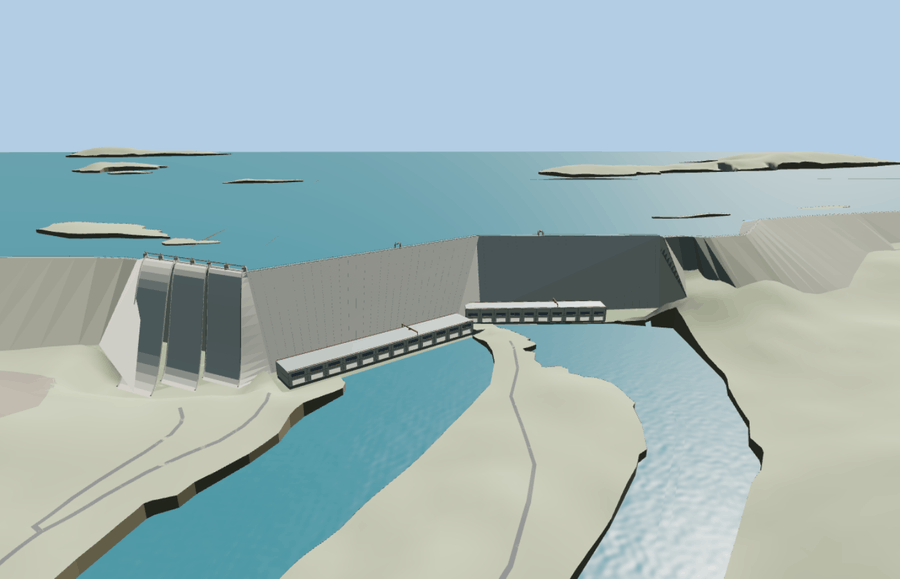

# Guri Dam

The 6.53 km barrier includes both rock-fill wings, an angular concrete gravity wall, two generating halls with recessed outfalls and three chutes below six closed gates. Concrete abutments now join the chutes and both ends of the wall to the rest of the barrier.

The principal mapped reservoir renders at 269.58 m and the Caroní tailrace at 124.58 m. Three local grades expose the two powerhouse aprons and the chute exits. The signed model replaces the two mapped powerhouse footprints while preserving the native river island, roads, bridge and neighboring buildings.

The Earth fixture retains all three mapped service road records. The ground opening follows the upper central arch. Failed loading preserves the native layers. Eviction restores the ground and releases model geometry.

| Detail level | Triangles | Download bytes | Draws |
| --- | ---: | ---: | ---: |
| skyline | 581 | 53,572 | 1 |
| district | 1,897 | 184,672 | 7 |
| street | 9,003 | 799,864 | 7 |
| closeup | 18,469 | 1,607,424 | 7 |

Skyline and district total 238,244 bytes. Six GLBs pass Khronos validation and contain zero embedded images. Six shared material graphs bind in the near viewer tiers. The review covers 71 renders and 115 geographic samples.

The water stages, banks and apron grades are representative. The separate western reservoir polygon retains its terrain-sampled level about one metre above the principal pool. Coarse terrain leaves angular banks and localized variation at the joins.

This model shows the static exterior with closed gates. Outfall bay dimensions and concealed generating equipment are approximate.

[Mapped site frame](map-frame.json) · [Terrain and water fit](site-fit.json) · [QA evidence](qa.json)
