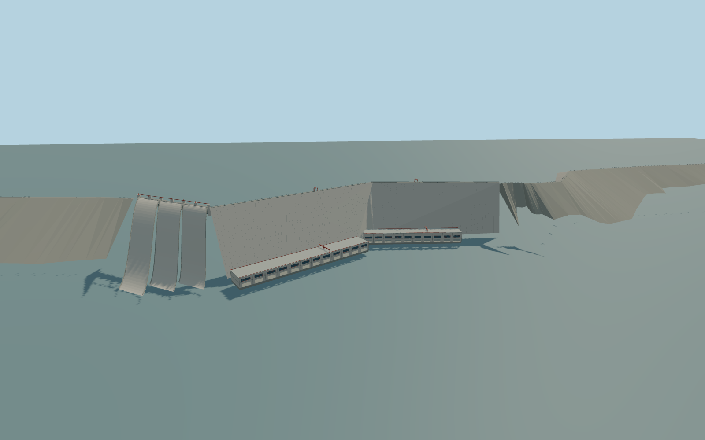

# Guri Dam

Complete retained 6.53km Guri hydraulic barrier: both bent rock-fill wings,angular two-face concrete gravity core,two native-plan downstream powerhouse halls,three spillway chutes with six interpreted gate bays,crest road,red gate frames and two service gantry cranes. Downstream access bridge,substations,independent neighborhood buildings and roads stay native context. Static closed gate configuration;no people,vehicles,lettering or fluid simulation.

Rebuild: `node packages/worldgen/scripts/generate-guri-dam.mjs`;append `--check` for exact source bytes. Select import/LOD/placement with `--ids=guri_dam`. Detailed source and four browser tiers are separate ignored GLB outputs.

Complete retained 6.53km Guri hydraulic barrier: both bent rock-fill wings,angular two-face concrete gravity core,two native-plan downstream powerhouse halls,three spillway chutes with six interpreted gate bays,crest road,red gate frames and two service gantry cranes. Downstream access bridge,substations,independent neighborhood buildings and roads stay native context. Static closed gate configuration;no people,vehicles,lettering or fluid simulation.

One common model reference equals the unmodified standard viewer reservoir sample at local[0,600],269.578615m. Authored crest is+14m,tailwater-145m,powerhouse floors-141/-138m with29/24m hall heights;all hydraulic and facade levels are picture-scale estimates,not surveyed. No per-component terrain snapping. Native terrain outside physical owned barrier/hall masks is unchanged.

Exact-Q retained barrier relation plus two ordinary aerials and current standard PMTiles. The retained length fact7000m and actual selected6530.518m longitudinal extent are different controls,not identical surveys. Crest,tailwater,wall slopes,industrial bays,gate inventory and crane machinery are picture-scale interpretations. Three main spillway chutes/six paired bays are simplified static closed gates;no baked whitewater or fluid-operation claim. No copied images,logos,lettering,people,vehicles or interiors. Independent downstream access bridge,substations and17 building components remain native. Standard terrain has known coarse/void artifacts;exact water/shore and device/dense-city performance remain unmeasured.

Six existing shared256px graphs:gravel,stone_basalt,concrete_plain,metal_standing_seam,metal_painted,window_grid. Seven near material groups maximum and one far palette group;metric UVs,linear colours,zero embedded/private textures. Shared gravel/stone for rock-fill faces,concrete for walls/foundations/road,roof metal,red crane/gate steel and actual glazing. No common-library changes invalidate other models. Every tier retains both whole bent earth wings,angular concrete core,both main powerhouse halls and three spillway chutes with six closed gates. District adds hall/window rhythm and red gantries;street cuts actual outfall openings/window recesses and adds wall joints/rails;close-up/master add finer mullions,crane bracing and denser crest posts. Numerical LOD errors20/10/3/1m are unmeasured authoring guidance.

Original geometry:repository license. Map:© OpenStreetMap contributors,ODbL-1.0;Protomaps. Standard terrain:terrain-grid.json. Ordinary pictures stay local and are not redistributed or used as textures. Current acceptance:qa.json.
