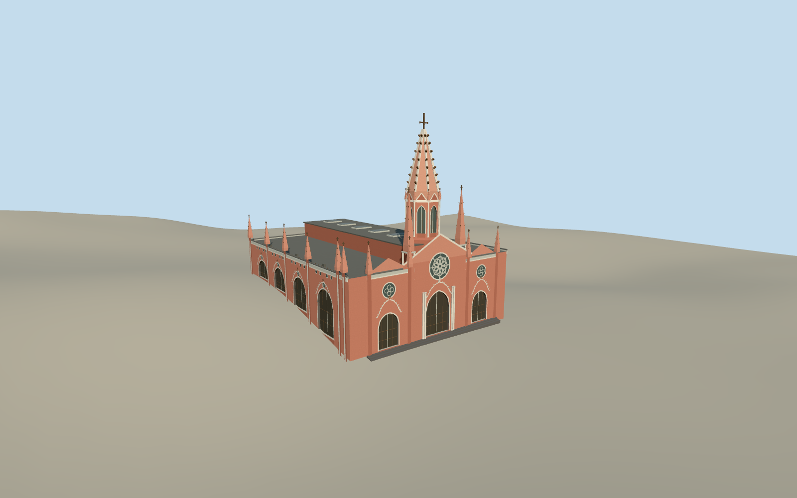

# Basilica of Santa Capilla, Caracas

Caracas’s standing salmon-painted Santa Capilla, with pale Gothic mouldings, a long arcaded street wall, three west portals and the slender crowning cross.

Authoring state: **review-in-qa.json**. Current completion evidence is in [qa.json](qa.json) and the [completion ledger](../../../../qualla-structures/batches/qualla-003.PROGRESS.md).

- [Basilica of Santa Capilla](https://qualla.com/basilica-of-santa-capilla/)

The footprint is the named mapped 27.8 m entrance front and approximately 34 m principal basilica depth. Surrounding buildings and street objects are outside the model.

Two exact 2014 exterior originals control the salmon, pale mouldings, prominent Urdaneta side arches and octagonal steeple. The west portal follows the restoration architect’s description. Its opening sizes, the rose and fine sculpture use approximate profiles.

The 30.05 m cross finial height, lancet positions, unpictured roof equipment and the less visible rear elevation are working estimates. The principal roofs follow documented concrete covers and the central skylight arrangement.

The original terrain is unchanged. Local street grade, threshold levels and height against the mapped terrain remain approximate.

Build: `node content/worldgen/source/places/d9/d9b/basilica_of_santa_capilla/models/generate-santa-capilla.mjs`. Add `--check` to verify exact regeneration. 11968 triangles; 6 materials; no embedded photographs.
