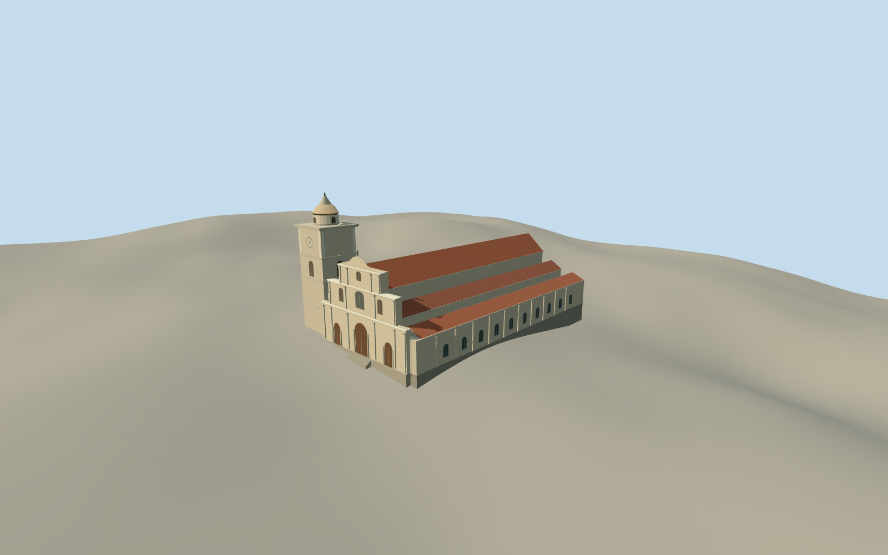

# Caracas Cathedral

Santa Ana Cathedral in Caracas with broad tile roofs, white stepped Baroque entrance and the historic clock and bell tower.

Authoring state: **review-in-qa.json**. Current completion evidence is in [qa.json](qa.json) and the [completion ledger](../../../../qualla-structures/batches/qualla-003.PROGRESS.md).

- [Caracas Cathedral](https://qualla.com/caracas-cathedral/)

Section and tower heights, nave roof arrangements, window design, current ornament and vertical registration are approximate. The standing exterior combines exact archival imagery with the modern written inventory.

The model covers the cathedral’s envelope, attached sacristy and chapels. The separately mapped Museo Sacro, surrounding plazas, freestanding statues and the interior are separate scopes.

Build: `node content/worldgen/source/places/d9/d9b/caracas_cathedral/models/generate-caracas-cathedral.mjs`. Add `--check` to verify exact regeneration. 3438 triangles; 5 materials; no embedded photographs.
