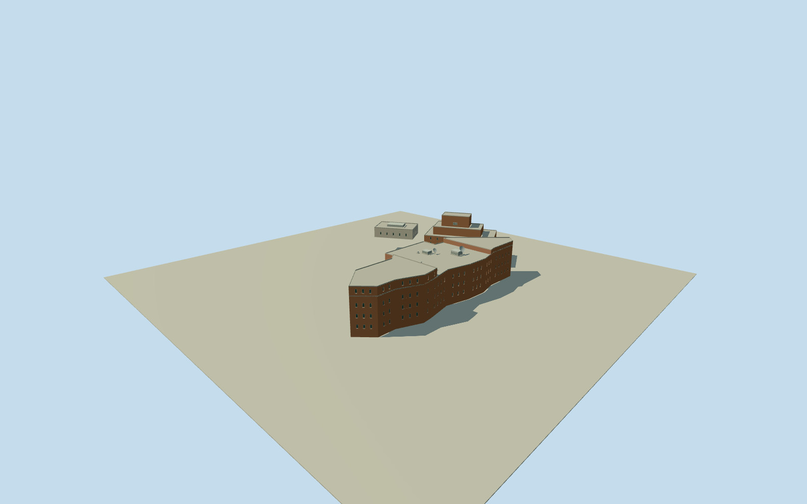

# Embassy of the United States, Caracas

Whole photographed USembassyCaracas mainchancery and two intrinsicnorthern/westernsupportblocks inside actualway342998158/Q20994812 compound: fullnative18controlmainbuilding330875684/fourcontrolnorthblock153825282/fourcontrolwestserviceblock816348036, redbrick stepped flatroofmasses, narrow recessedwindowrows, tallerend/cornerblocks and boundedroofmechanicalvolumes. Preserveall26native architecturalcontrols and completeall-sidebuildingbodies. Compoundfence/park/roads/vegetation/guardentrance/vehicles/flag/lettering/privateinteriors excluded; no wholelandscapeextrusion. Hiddenback/roof/sections/individualblockroles andcurrentfinish estimated from clear2015publishedQuallaCC0photo plus actualnativegeometry. Operational/diplomaticstatus is not model geometry.

Authoring state: **review-in-qa.json**. Current completion evidence is in [qa.json](qa.json) and the [completion ledger](../../../../qualla-structures/batches/qualla-002.PROGRESS.md).

- [Embassy of the United States, Caracas](https://qualla.com/embassy-of-the-united-states-caracas/)

Actual USembassycompoundway342998158/CalleSuapure/countryUS/diplomaticembassy establishes physicalidentityQ20994812. Main18controlchanceryfootprintway330875684 and adjacentintrinsicnorthernfourcontrolblock153825282/westernfourcontrolserviceblock816348036 retained as wholethreebuilding architecturegroup (26uniquecontrols). Compound59nodefenceline is contextualidentity only, not an inventedsolidbuilding orfittedgroundplate. Fixedwholethreebuildingbboxmidpoint/+Xeast/+Zsouth/heading0. No1958historicNixonembassypremises substituted for the modern photographedchancery. Exactindividualinternalbuildingrole/hiddenroof/floorsections unsurveyed.

Independent600mfield/16641samples/four originalrawtiles frozen before everyfloor/section/geometry decision. FixedSWproviderdatum994.0135m; separateflatstructural referencefloors main-10m/north-6m/west+3m are bounded unsurveyed architectural estimates on a steep hillside, never edits/fits to originalground. Main whole18controlbody floor-10..9.5m with highernative-clipped southend14m/northend12m, three narrowwindowranks andsouthendupperrank, .24mwindowrecesses/.42mparapet. Northernfourcontrolblock floor-6..8m andtwo insetsteppedroofvolumes to13/20m, westernfourcontrolserviceblock floor3..9.6m. Mainroofequipment/smallbowldishes from visiblephotofamily, exactconfiguration/census estimated. Separatefloorlevels andcoarse urbanDEM cannotcertify precisehostfooting/thresholdcontact: diagnosticflatground mayleave higherblocks suspended; inspectunchangedsourceground separately. Wholethreebuildinggroup/all26 nativecontrols retained, no compoundfence/guardbooth/landscapeplate/roads/vegetation/privateinterior. Hiddenbacks/blockroles/sections/currentfinish originalboundedestimates; sourcegrid/PNG/rawtilesunchanged, geographicpreview/replaceFootprintfalse.

Whole modernchanceryarchitecturegroup/all26nativecontrols: complete18controlmainbuilding/twofourcontrolintrinsicblocks, redbrickmasses/narrowwindowrows/raisednative-clippedmainends/insetnorthroofboxes/palewestserviceblock/boundedvisibleplantanddishvocabulary. Compoundfence/guardbooths/park/roads/landscape/flag/lettering/privateinteriors andhistoric1958premises excluded.

Onlyexact2684x1796 ZiaLater2015Own/selfCC0 publishedQuallaoriginal/nativeSHA1matched/personallyinspected. Existingimageryinventorypassed after provenance lookup followed originalPNG MIME; no sourcebody/media/rightsmetadata changes or supplementary imagery/generatedphotographs/photo textures.

Blockroles/floorreferences/hiddenfacades/windowcensus/roofsections/plant-anddishconfiguration/currentfinish are originalbounded estimates. Modern physicalbuilding only, no claim aboutcurrentdiplomaticoperations. Flat reviewground cannot represent separatehillsidefloorlevels, so higherblocks mayfloat in diagnosticviews; inspect originalsourceground separately.

Independent600m129x129field/16641samples/four rawtiles frozen before anyfloors/geometry. Fixed994.0135m provider datum andflatmain-10/north-6/west+3m referencefloors unsurveyed. Groundgrid/PNG/rawtiles unchanged; precisefooting/threshold/hostcontact unresolved, geographicpreview/replaceFootprintfalse; no fittedterrain or artificialsiteplate.

Build: `node packages/worldgen/scripts/generate-authored-places.mjs --ids=embassy_of_the_united_states_caracas`. Add `--check` to verify exact regeneration. 10680 triangles; 5 materials; no embedded photographs.
